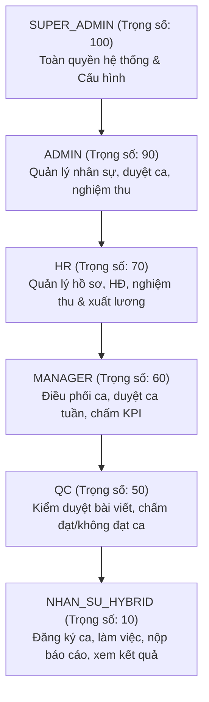

# DANH SÁCH TÍNH NĂNG & MA TRẬN PHÂN QUYỀN (RBAC)
> **Dự án:** Web Quản Lý Nhân Sự Hybrid - Freetrip  
> **Phiên bản:** 1.0 (Production-Ready)  
> **Thư mục lưu trữ:** [docs/danh_sach_tinh_nang_va_ma_tran_phan_quyen.md](file:///d:/Quang/Cong%20Viec%20Dev/WebHybrid/docs/danh_sach_tinh_nang_va_ma_tran_phan_quyen.md)  

---

## MỤC LỤC
1. [Hệ Thống Phân Cấp Vai Trò (Roles & Hierarchy)](#1-hệ-thống-phân-cấp-vai-trò-roles--hierarchy)
2. [Ma Trận Phân Quyền Truy Cập (RBAC Matrix)](#2-ma-trận-phân-quyền-truy-cập-rbac-matrix)
3. [Danh Mục Chi Tiết Toàn Bộ Tính Năng Hiện Có](#3-danh-mục-chi-tiết-toàn-bộ-tính-năng-hiện-có)
   - [Module 1: Xác thực & Điều hướng (Auth & Routing)](#module-1-xác-thực--điều-hướng-auth--routing)
   - [Module 2: Dashboard Tổng quan (Home)](#module-2-dashboard-tổng-quan-home)
   - [Module 3: Quản lý Hồ sơ nhân sự & Hợp đồng (HRM)](#module-3-quản-lý-hồ-sơ-nhân-sự--hợp-đồng-hrm)
   - [Module 4: Quản lý & Đăng ký Ca làm việc (Shifts)](#module-4-quản-lý--đăng-ký-ca-làm-việc-shifts)
   - [Module 5: Báo cáo Seeding & Săn thưởng Viral (Reports)](#module-5-báo-cáo-seeding--săn-thưởng-viral-reports)
   - [Module 6: Hàng đợi kiểm duyệt & Chấm điểm QC (QC Reviews)](#module-6-hàng-đợi-kiểm-duyệt--chấm-điểm-qc-qc-reviews)
   - [Module 7: Đánh giá KPI & Xếp loại tuần (Weekly KPI)](#module-7-đánh-giá-kpi--xếp-loại-tuần-weekly-kpi)
   - [Module 8: Nghiệm thu tháng & Biên bản thanh toán (Acceptance)](#module-8-nghiệm-thu-tháng--biên-bản-thanh-toán-acceptance)
   - [Module 9: Cài đặt hệ thống & Quản trị trung tâm (Admin)](#module-9-cài-đặt-hệ-thống--quản-trị-trung-tâm-admin)
4. [Các Bộ Quy Tắc Nghiệp Vụ Cốt Lõi (Business Rules & Constraints)](#4-các-bộ-quy-tắc-nghiệp-vụ-cốt-lõi-business-rules--constraints)
   - [Rule 1: Quy tắc Hợp đồng & Thời gian thử việc](#rule-1-quy-tắc-hợp-đồng--thời-gian-thử-việc)
   - [Rule 2: Quy tắc Đăng ký ca & Ràng buộc chuyên cần](#rule-2-quy-tắc-đăng-ký-ca--ràng-buộc-chuyên-cần)
   - [Rule 3: Quy tắc Điểm danh & Xử lý đi muộn](#rule-3-quy-tắc-điểm-danh--xử-lý-đi-muộn)
   - [Rule 4: Quy tắc Tiêu chuẩn nội dung Seeding](#rule-4-quy-tắc-tiêu-chuẩn-nội-dung-seeding)
   - [Rule 5: Quy tắc SLA Thời hạn kiểm duyệt QC](#rule-5-quy-tắc-sla-thời-hạn-kiểm-duyệt-qc)
   - [Rule 6: Quy tắc Bậc thưởng Viral (Facebook / Threads)](#rule-6-quy-tắc-bậc-thưởng-viral-facebook--threads)
   - [Rule 7: Quy tắc Điều kiện hưởng thù lao & Nghiệm thu tháng](#rule-7-quy-tắc-điều-kiện-hưởng-thù-lao--nghiệm-thu-tháng)

---

## 1. Hệ Thống Phân Cấp Vai Trò (Roles & Hierarchy)

Hệ thống được thiết kế theo mô hình **RBAC (Role-Based Access Control)** với trọng số thứ bậc xác định trong [auth.ts](file:///d:/Quang/Cong%20Viec%20Dev/WebHybrid/app/src/lib/auth.ts):

| Tên Role | Trọng số | Mô tả đối tượng người dùng |
|----------|----------|----------------------------|
| `SUPER_ADMIN` | **100** | Quản trị viên cấp cao nhất. Có quyền cấu hình hệ thống, reset mật khẩu, thiết lập KPI và thang thưởng. |
| `ADMIN` | **90** | Ban giám đốc / Ban điều hành. Giám sát toàn diện mọi chỉ số nhân sự, ca kíp và tài chính. |
| `HR` | **70** | Chuyên viên Nhân sự. Quản lý hồ sơ nhân viên, in/ký hợp đồng, lập và chốt biên bản nghiệm thu tháng. |
| `MANAGER` | **60** | Trưởng nhóm Seeding / Quản lý trực tiếp. Phê duyệt ca tuần, khóa/mở ca, chấm điểm và xếp loại KPI tuần. |
| `QC` | **50** | Chuyên viên Kiểm soát chất lượng. Thẩm định báo cáo link bài, quét link tự động, đánh giá PASS/FAIL ca làm. |
| `NHAN_SU_HYBRID` | **10** | Nhân viên Seeding Hybrid. Đăng ký ca làm, nộp link báo cáo hàng ngày, săn thưởng Viral, xem KPI cá nhân. |

---

## 2. Ma Trận Phân Quyền Truy Cập (RBAC Matrix)

Ký hiệu:
- ✅ : Toàn quyền (Xem, Tạo, Sửa, Duyệt, Thao tác)
- 👁️ : Chỉ xem (Read-only)
- 👤 : Chỉ xem / thao tác dữ liệu cá nhân của chính mình
- ❌ : Không có quyền truy cập (Bị Middleware và API chặn)

| Module & Chức năng | Đường dẫn URL | SUPER_ADMIN | ADMIN | HR | MANAGER | QC | NHAN_SU_HYBRID |
|--------------------|---------------|:-----------:|:-----:|:--:|:-------:|:--:|:--------------:|
| **Dashboard Tổng quan** | `/` | ✅ | ✅ | ✅ | ✅ | ✅ | 👤 (View cá nhân) |
| **Hồ sơ nhân sự (CRUD)** | `/nhan-su` | ✅ | ✅ | ✅ | ❌ | ❌ | ❌ |
| **In & Ký Hợp đồng** | `/nhan-su` (Modal) | ✅ | ✅ | ✅ | ❌ | ❌ | ❌ |
| **Import / Export Nhân sự** | `/nhan-su` | ✅ | ✅ | ✅ | ❌ | ❌ | ❌ |
| **Đăng ký ca cá nhân** | `/ca-lam-viec` | ✅ | ✅ | ✅ | ✅ | ✅ | ✅ (Cá nhân) |
| **Ma trận duyệt ca tuần (Team Grid)** | `/ca-lam-viec` | ✅ | ✅ | 👁️ | ✅ | 👁️ | ❌ |
| **Khóa / Mở lại ca cá nhân (Reopen)** | `/ca-lam-viec` | ✅ | ✅ | ❌ | ✅ | ❌ | ❌ |
| **Nộp báo cáo Seeding & Viral** | `/bao-cao` | ✅ | ✅ | ✅ | ✅ | ✅ | ✅ (Cá nhân) |
| **Hàng đợi kiểm duyệt QC (Queue)** | `/kiem-duyet` | ✅ | ✅ | ❌ | ✅ | ✅ | ❌ |
| **Quét link tự động (Link Scanner)** | `/kiem-duyet` | ✅ | ✅ | ❌ | ✅ | ✅ | ❌ |
| **Chấm ca Đạt / Không đạt (Pass/Fail)** | `/kiem-duyet` | ✅ | ✅ | ❌ | ✅ | ✅ | ❌ |
| **Mở lại ca cho sửa báo cáo (Unlock)** | `/kiem-duyet` | ✅ | ✅ | ❌ | ✅ | ✅ | ❌ |
| **Xem bảng tổng hợp KPI tuần** | `/kpi` | ✅ | ✅ | ✅ | ✅ | 👁️ | ❌ |
| **Đánh giá chất lượng & Xếp loại KPI** | `/kpi` | ✅ | ✅ | ❌ | ✅ | ❌ | ❌ |
| **Duyệt mức thưởng Viral tuần** | `/kpi` | ✅ | ✅ | ❌ | ✅ | ❌ | ❌ |
| **Nghiệm thu tháng & Chốt thù lao** | `/nghiem-thu` | ✅ | ✅ | ✅ | ✅ | ❌ | ❌ |
| **Xuất Excel nghiệm thu (.xlsx)** | `/nghiem-thu` | ✅ | ✅ | ✅ | ✅ | ❌ | ❌ |
| **In Biên bản nghiệm thu (A4)** | `/nghiem-thu` | ✅ | ✅ | ✅ | ✅ | ❌ | ❌ |
| **Cài đặt hệ thống & KPI Config** | `/admin` | ✅ | ❌ | ❌ | ❌ | ❌ | ❌ |
| **Reset mật khẩu người dùng** | `/admin` & `/api` | ✅ | ✅ | ❌ | ❌ | ❌ | ❌ |

---

## 3. Danh Mục Chi Tiết Toàn Bộ Tính Năng Hiện Có

### Module 1: Xác thực & Điều hướng (Auth & Routing)
- **Đăng nhập hệ thống:** [`app/src/app/login/page.tsx`](file:///d:/Quang/Cong%20Viec%20Dev/WebHybrid/app/src/app/login/page.tsx)
  - Xác thực qua Số điện thoại + Mật khẩu.
  - Cấp token JWT (HS256) an toàn lưu trong Cookie `hybrid-token` (HttpOnly).
- **Middleware phân quyền tự động:** [`app/src/middleware.ts`](file:///d:/Quang/Cong%20Viec%20Dev/WebHybrid/app/src/middleware.ts)
  - Chặn các truy cập trái phép cấp URL trước khi load component.
  - Tự động inject header `x-user-id`, `x-user-role`, `x-user-name` cho backend xử lý.
- **Thanh điều hướng thông minh (Sidebar):** [`app/src/components/Sidebar.tsx`](file:///d:/Quang/Cong%20Viec%20Dev/WebHybrid/app/src/components/Sidebar.tsx)
  - Lọc động các menu tùy theo vai trò thực tế của người dùng đang đăng nhập.

---

### Module 2: Dashboard Tổng quan (Home)
- **Mã nguồn:** [`app/src/app/(dashboard)/page.tsx`](file:///d:/Quang/Cong%20Viec%20Dev/WebHybrid/app/src/app/(dashboard)/page.tsx)
- **Giao diện Quản lý (Manager Dashboard):**
  - Thống kê toàn diện: Tổng nhân sự, đang hoạt động, ca cần duyệt QC, hợp đồng sắp hết hạn trong 7-14 ngày.
  - Biểu đồ phân bổ ca hôm nay (Sáng / Chiều / Tối).
  - Tỷ lệ hoàn thành KPI trung bình toàn đội ngũ & Tổng tiền thưởng Viral tích lũy.
  - Lịch sử hoạt động gần đây theo thời gian thực.
- **Giao diện Nhân sự (Staff Dashboard):**
  - Thông tin hợp đồng cá nhân: Loại hợp đồng, ngày hết hạn, số ngày còn lại, cảnh báo gia hạn.
  - Chỉ số cá nhân trong tuần: Số ca đã đăng ký, số ca đã được duyệt.
  - Thống kê tháng: Báo cáo đã nộp, số ca Đạt (Pass), Chờ duyệt (Pending), Không đạt (Fail).
  - Thẻ ca trực hôm nay kèm nút nộp báo cáo tức thì.

---

### Module 3: Quản lý Hồ sơ nhân sự & Hợp đồng (HRM)
- **Mã nguồn:** [`app/src/app/(dashboard)/nhan-su/page.tsx`](file:///d:/Quang/Cong%20Viec%20Dev/WebHybrid/app/src/app/(dashboard)/nhan-su/page.tsx)
- **Tính năng chi tiết:**
  - **Quản lý danh sách nhân sự:** Tìm kiếm theo tên/SĐT/CCCD; lọc theo Vai trò, Trạng thái (Thử việc, Chính thức, Đã nghỉ, Tạm đình chỉ), Trạng thái hợp đồng.
  - **Thêm mới / Chỉnh sửa hồ sơ:** Nhập thông tin hành chính, số CCCD, tài khoản ngân hàng, ngày bắt đầu, tùy chọn tạo ngay hợp đồng 3 tháng.
  - **Hệ thống cảnh báo hợp đồng:** Huy hiệu màu trực quan (Chưa có HĐ, Còn <14 ngày, Còn <7 ngày, Đã hết hạn).
  - **Gia hạn hợp đồng nhanh:** Form tự động tính chu kỳ gia hạn 3 tháng tiếp theo.
  - **In & Xuất hợp đồng thỏa thuận làm việc:** [`ContractPrintModal.tsx`](file:///d:/Quang/Cong%20Viec%20Dev/WebHybrid/app/src/components/nhan-su/ContractPrintModal.tsx) và backend tạo file Word [`docx-contract.ts`](file:///d:/Quang/Cong%20Viec%20Dev/WebHybrid/app/src/lib/docx-contract.ts) tự động điền họ tên, CCCD, thông tin ngân hàng của nhân viên.
  - **Nhập / Xuất Excel:** Hỗ trợ nhập danh sách ban đầu từ bảng tính và kết xuất dữ liệu.

---

### Module 4: Quản lý & Đăng ký Ca làm việc (Shifts)
- **Mã nguồn:** [`app/src/app/(dashboard)/ca-lam-viec/page.tsx`](file:///d:/Quang/Cong%20Viec%20Dev/WebHybrid/app/src/app/(dashboard)/ca-lam-viec/page.tsx)
- **Tính năng chi tiết:**
  - **Đăng ký ca cá nhân (Weekly Calendar):**
    - Tick chọn ca: Sáng (08:30-12:30), Chiều (13:30-17:30), Tối (20:00-24:00).
    - Lựa chọn hình thức: Làm Online hoặc làm Offline tại văn phòng.
    - Bộ đếm tiến độ: Đếm số ca/tuần và kiểm tra chỉ tiêu tối thiểu 1 ca Offline.
  - **Ma trận ca toàn đội ngũ (Team Grid Matrix):**
    - Quản lý quan sát toàn bộ nhân viên x các ngày trong tuần trên một bảng ma trận duy nhất.
    - Đếm tổng số lượng người trực từng ca để phát hiện thiếu/thừa ca.
  - **Duyệt ca kíp:**
    - Nút duyệt hàng loạt tất cả ca hợp lệ của tuần.
    - Duyệt / Từ chối từng ca đơn lẻ của từng nhân sự kèm lý do.
  - **Cơ chế Khóa & Mở lại (Lock / Reopen):**
    - Tự động đóng cổng đăng ký lúc 23:59 Chủ Nhật.
    - Cho phép Quản lý mở lại quyền đăng ký riêng cho từng nhân viên đặc biệt khi có lý do chính đáng.

---

### Module 5: Báo cáo Seeding & Săn thưởng Viral (Reports)
- **Mã nguồn:** [`app/src/app/(dashboard)/bao-cao/page.tsx`](file:///d:/Quang/Cong%20Viec%20Dev/WebHybrid/app/src/app/(dashboard)/bao-cao/page.tsx)
- **Tính năng chi tiết:**
  - **Lựa chọn ca làm việc:** Chỉ cho phép nộp báo cáo cho các ca đã được Quản lý duyệt (`APPROVED`).
  - **Trường nhập liệu chuẩn hóa:**
    - 10 ô link bài viết Facebook chính thức.
    - Danh sách link bài viết Facebook bổ sung (dự phòng khi bị kiểm duyệt gỡ bài).
    - 4 ô link bài viết Threads.
    - 1 ô link Google Drive công khai chứa ảnh chụp màn hình 50 comments.
    - Danh sách link bài viết nội dung nữ (Content Nữ).
  - **Đăng ký xét thưởng Viral:**
    - Cho phép nộp link bài đăng hoặc bình luận đạt lượng like cao.
    - Hệ thống tự động so khớp bậc thưởng dự kiến dựa trên số like khai báo.
  - **Lịch sử & Phản hồi QC:**
    - Xem danh sách các báo cáo đã nộp, trạng thái thẩm định của QC (Đang chờ / Đạt / Không đạt) và nhận xét phản hồi chi tiết.

---

### Module 6: Hàng đợi kiểm duyệt & Chấm điểm QC (QC Reviews)
- **Mã nguồn:** [`app/src/app/(dashboard)/kiem-duyet/page.tsx`](file:///d:/Quang/Cong%20Viec%20Dev/WebHybrid/app/src/app/(dashboard)/kiem-duyet/page.tsx)
- **Tính năng chi tiết:**
  - **Hàng đợi kiểm duyệt thông minh (Review Queue):**
    - Sắp xếp ưu tiên các ca gần hết hạn kiểm duyệt trước.
    - Hiển thị nhãn đếm ngược SLA 7 ngày: Xanh (An toàn), Vàng (Cảnh báo), Đỏ (Quá hạn).
  - **Công cụ quét link tự động (Link Scanner):**
    - Quét tự động danh sách URL của báo cáo: kiểm tra mã phản hồi HTTP, đọc metadata tiêu đề bài viết, ảnh xem trước OpenGraph, phát hiện link lỗi/link chết ngay lập tức.
  - **Chấm điểm chi tiết từng hạng mục:**
    - Nhập số bài Facebook hợp lệ (Chuẩn 10).
    - Nhập số bài Threads hợp lệ (Chuẩn 4).
    - Nhập số comment hợp lệ (Chuẩn 50).
  - **Cảnh báo đi muộn / Vắng mặt:**
    - Hiển thị thời gian login của phiên làm việc. Tự động cảnh báo nếu nhân sự vào làm trễ trên 60 phút.
  - **Đánh giá Đạt / Không đạt & Mở khóa ca:**
    - Quyết định kết quả cuối cùng: `PASS` hoặc `FAIL`.
    - Gửi nhận xét phản hồi để nhân viên rút kinh nghiệm.
    - Nút **"Mở khóa ca" (Unlock)** để nhân viên được quyền sửa đổi và nộp lại báo cáo nếu thiếu sót có thể khắc phục.

---

### Module 7: Đánh giá KPI & Xếp loại tuần (Weekly KPI)
- **Mã nguồn:** [`app/src/app/(dashboard)/kpi/page.tsx`](file:///d:/Quang/Cong%20Viec%20Dev/WebHybrid/app/src/app/(dashboard)/kpi/page.tsx)
- **Tính năng chi tiết:**
  - **Tổng hợp tự động theo tuần:**
    - Tính tổng số ca hoàn thành, tổng số bài viết FB/Threads và tổng comment thực tế.
    - Tính tỷ lệ hoàn thành KPI (%) so với định mức giao.
    - So sánh và tính tỷ lệ tăng trưởng (%) sản lượng so với tuần trước.
  - **Đánh giá chất lượng định tính (Form Review):**
    - Nhận xét chất lượng bài viết Facebook.
    - Nhận xét chất lượng bài viết Threads.
    - Nhận xét kỹ thuật seeding comment.
    - Nhận xét kỹ năng chăm sóc và tương tác lại bài viết (Post Care).
  - **Duyệt thưởng bài viết Viral:**
    - Xem danh sách link bài viral trong tuần của nhân sự, xác nhận số like và chốt số tiền thưởng tuần.
  - **Xếp loại thi đua tuần:**
    - Phân loại: *Xuất sắc (Excellent), Tốt (Good), Khá (Fair), Cần cố gắng (Needs Improvement), Không tốt (Poor)*.

---

### Module 8: Nghiệm thu tháng & Biên bản thanh toán (Acceptance)
- **Mã nguồn:** [`app/src/app/(dashboard)/nghiem-thu/page.tsx`](file:///d:/Quang/Cong%20Viec%20Dev/WebHybrid/app/src/app/(dashboard)/nghiem-thu/page.tsx)
- **Tính năng chi tiết:**
  - **Bảng tổng hợp nghiệm thu tháng:**
    - Tổng hợp toàn bộ nhân viên trong tháng: Số ca hoàn thành (Đạt), Tổng bài viết, Tổng comment, Tổng gói sản phẩm bàn giao, Thưởng Viral tích lũy.
  - **Tự động thẩm định điều kiện hưởng thù lao:**
    - Cảnh báo nhân viên làm dưới 3 ngày (`BELOW_MIN`).
    - Cảnh báo nhân viên nghỉ quá 3 ca trong tháng (`EXCESS_ABSENT`).
    - Xác nhận nhân viên đủ điều kiện tính trọn gói (`QUALIFIED`).
  - **Xem chi tiết lịch sử ca trong tháng:**
    - Modal popup cho phép xem từng ngày làm việc, giờ vào ca, kết quả chấm QC và lý do đạt/hỏng.
  - **Quy trình chốt trạng thái:**
    - `DRAFT` (Bản thảo đang tổng hợp) -> `CONFIRMED` (Quản lý/HR xác nhận khóa số liệu) -> `EXPORTED` (Đã xuất thanh toán).
  - **Kết xuất file Excel chuẩn Freetrip:**
    - Xuất file `.xlsx` định dạng chính xác theo Biên Bản Nghiệm Thu truyền thống của Freetrip.
  - **In Biên bản nghiệm thu (A4 Print Mode):**
    - Bản in chuyên nghiệp với đầy đủ đại diện ký tên: *Phụ trách nghiệm thu*, *Quản lý trực tiếp*, *Đại diện công ty*.

---

### Module 9: Cài đặt hệ thống & Quản trị trung tâm (Admin)
- **Mã nguồn:** [`app/src/app/(dashboard)/admin/page.tsx`](file:///d:/Quang/Cong%20Viec%20Dev/WebHybrid/app/src/app/(dashboard)/admin/page.tsx)
- **Tính năng chi tiết:**
  - **Quản lý danh sách tài khoản:**
    - Phân quyền (Role), Khóa/Mở tài khoản, Đặt lại mật khẩu.
  - **Cấu hình chỉ tiêu KPI:**
    - Thay đổi định mức số bài FB/ca, Threads/ca, Comments/ca, số ca tối thiểu/tuần, số ngày tối thiểu hưởng lương.
  - **Cấu hình thời gian ca làm & Quy tắc:**
    - Điều chỉnh giờ bắt đầu/kết thúc các ca, thời điểm tự động mở và đóng cổng đăng ký tuần.
  - **Cấu hình bảng bậc thưởng Viral:**
    - Thêm/sửa/xóa các mốc like và mức tiền thưởng cho cả Facebook và Threads.

---

## 4. Các Bộ Quy Tắc Nghiệp Vụ Cốt Lõi (Business Rules & Constraints)

### Rule 1: Quy tắc Hợp đồng & Thời gian thử việc
- **Thử việc:** Nhân sự mới vào được phân loại trạng thái `PROBATION` trong **1 tuần đầu tiên**. Trong thời gian thử việc chưa ký hợp đồng chính thức.
- **Thời hạn hợp đồng:** Hợp đồng thỏa thuận làm việc (khoán việc) có thời hạn chuẩn là **3 tháng**.
- **Cảnh báo hết hạn:** Hệ thống tự động kích hoạt cảnh báo vàng khi hợp đồng còn dưới **14 ngày** và cảnh báo đỏ khi còn dưới **7 ngày**.

### Rule 2: Quy tắc Đăng ký ca & Ràng buộc chuyên cần
- **Giới hạn số ca/ngày:** Mỗi nhân sự chỉ được đăng ký tối đa **1 ca trong 1 ngày**.
- **Chỉ tiêu tuần:** Mỗi nhân sự phải đăng ký và làm việc tối thiểu **5 ca / tuần** (tương đương tối thiểu 20 ca / tháng).
- **Yêu cầu ca trực tiếp (OFFLINE):** Bắt buộc phải có ít nhất **1 ca làm việc trực tiếp tại văn phòng** trong các ngày từ Thứ 2 đến Thứ 6.
- **Giới hạn nghỉ phép:** Mỗi nhân sự chỉ được phép nghỉ tối đa **3 ca / 20 ca quy định trong 1 tháng**. Phải xin nghỉ trước tối thiểu **1 ngày**.

### Rule 3: Quy tắc Điểm danh & Xử lý đi muộn
- **Khung giờ ca:**
  - Ca Sáng: 08:30 - 12:30
  - Ca Chiều: 13:30 - 17:30
  - Ca Tối: 20:00 - 24:00
- **Ngưỡng đi muộn:** Nếu nhân sự đăng nhập vào hệ thống muộn quá **60 phút** so với giờ bắt đầu ca, hệ thống sẽ tự động gắn cờ cảnh báo vi phạm chuyên cần `isLate = true` và ghi nhận số phút muộn `lateMinutes`.

### Rule 4: Quy tắc Tiêu chuẩn nội dung Seeding
- **Chỉ tiêu mỗi ca:**
  - Facebook: **10 bài viết**.
  - Threads: **4 bài viết**.
  - Bình luận: **50 bình luận** (phải có link drive ảnh chụp màn hình chứng minh).
- **Từ khóa bắt buộc:** Mọi bài viết phải chứa các từ khóa chiến dịch như: `freetrip`, `free.trip`, `mã qr`, `secretchat`, `fastdate`.
- **Hành vi cấm:** Nghiêm cấm sử dụng khung chat hoặc nhắc tên bất kỳ ứng dụng hẹn hò/đối thủ cạnh tranh nào khác.

### Rule 5: Quy tắc SLA Thời hạn kiểm duyệt QC
- **Thời hạn thẩm định:** Mỗi ca làm việc phải được đội ngũ QC thẩm định trong vòng tối đa **7 ngày** kể từ thời điểm kết thúc ca.
- **Trạng thái SLA:**
  - `SAFE`: Còn trên 2 ngày.
  - `WARNING`: Còn từ 1 đến 2 ngày.
  - `OVERDUE`: Quá hạn 7 ngày chưa duyệt (hệ thống cảnh báo đỏ nổi bật trên Dashboard).

### Rule 6: Quy tắc Bậc thưởng Viral (Facebook / Threads)

#### Bậc thưởng cho Bài đăng (Posts):
| Nền tảng | Ngưỡng tương tác | Số tiền thưởng (VNĐ) |
|:--------:|:----------------:|:--------------------:|
| **Facebook** | 500 Likes | 50,000 VNĐ |
| **Facebook** | 1,000 Likes | 80,000 VNĐ |
| **Facebook** | 3,000 Likes | 100,000 VNĐ |
| **Facebook** | 5,000 Likes | 200,000 VNĐ |
| **Threads** | 1,000 Likes | 50,000 VNĐ |
| **Threads** | 3,000 Likes | 80,000 VNĐ |
| **Threads** | 5,000 Likes | 100,000 VNĐ |
| **Threads** | 10,000 Likes | 200,000 VNĐ |

#### Bậc thưởng cho Bình luận (Comments):
| Nền tảng | Ngưỡng tương tác | Số tiền thưởng (VNĐ) |
|:--------:|:----------------:|:--------------------:|
| **Facebook** | 500 Likes | 25,000 VNĐ |
| **Facebook** | 1,000 Likes | 50,000 VNĐ |
| **Facebook** | 5,000 Likes | 80,000 VNĐ |
| **Facebook** | 10,000 Likes | 100,000 VNĐ |
| **Threads** | 1,000 Likes | 25,000 VNĐ |
| **Threads** | 5,000 Likes | 50,000 VNĐ |
| **Threads** | 10,000 Likes | 80,000 VNĐ |
| **Threads** | 50,000 Likes | 100,000 VNĐ |

### Rule 7: Quy tắc Điều kiện hưởng thù lao & Nghiệm thu tháng
- **Điều kiện tối thiểu (3 ngày):** Nhân sự phải làm việc tích lũy tối thiểu **3 ca ĐẠT** trong tháng mới đủ điều kiện được tính thù lao khoán việc. Nhân sự dưới 3 ca sẽ bị hệ thống phân loại `BELOW_MIN` và giữ lại để xử lý riêng.
- **Ràng buộc số ca nghỉ:** Nếu nghỉ quá 3 ca trong tháng, hệ thống gắn cờ `EXCESS_ABSENT` để người phụ trách nghiệm thu xem xét trừ chế độ hoặc xử lý kỷ luật trước khi chốt thù lao.
- **Quy trình nghiệm thu:**
  1. Ngày 01 - 05 đầu tháng: Lập bảng nghiệm thu nháp (`DRAFT`).
  2. Phụ trách nghiệm thu và Quản lý thẩm định số liệu, bấm xác nhận (`CONFIRMED`).
  3. Xuất file Excel chuẩn (`EXPORTED`) gửi Kế toán chi trả và in bản giấy lưu trữ hồ sơ công ty.
