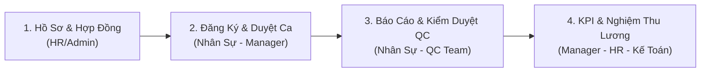
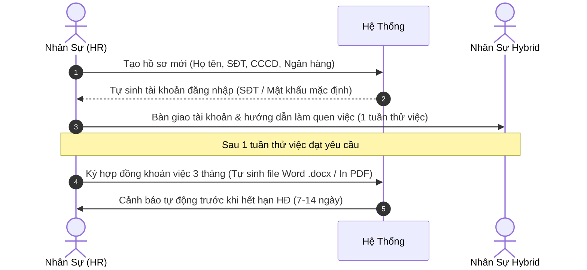
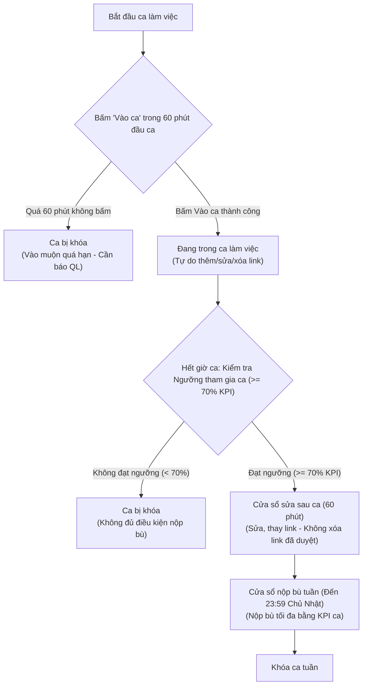
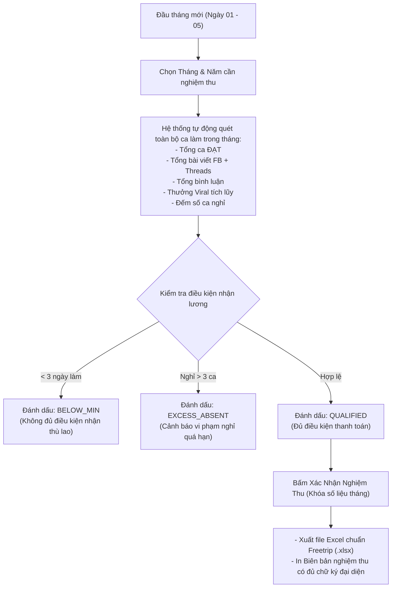

# TÀI LIỆU HƯỚNG DẪN SỬ DỤNG HỆ THỐNG QUẢN LÝ NHÂN SỰ HYBRID (TỪ A ĐẾN Z)
> **Dự án:** Web Quản Lý Nhân Sự Hybrid - Freetrip  
> **Phiên bản:** 1.0 (Production-Ready)  
> **Đối tượng sử dụng:** Super Admin, Admin, HR, Manager, QC, Nhân sự Seeding Hybrid  

---

## MỤC LỤC
1. [Giới Thiệu Tổng Quan Hệ Thống](#1-giới-thiệu-tổng-quan-hệ-thống)
2. [Kiến Trúc & Môi Trường Hoạt Động](#2-kiến-trúc--môi-trường-hoạt-động)
3. [Hướng Dẫn Đăng Nhập & Bắt Đầu](#3-hướng-dẫn-đăng-nhập--bắt-đầu)
4. [Quy Trình Nghiệp Vụ Vận Hành End-to-End Từ A - Z](#4-quy-trình-nghiệp-vụ-vận-hành-end-to-end-từ-a---z)
   - [Giai đoạn 1: Tiếp nhận & Quản lý hồ sơ nhân sự (HR/Admin)](#giai-đoạn-1-tiếp-nhận--quản-lý-hồ-sơ-nhân-sự-hradmin)
   - [Giai đoạn 2: Đăng ký ca làm việc tuần (Nhân sự & Quản lý)](#giai-đoạn-2-đăng-ký-ca-làm-việc-tuần-nhân-sự--quản-lý)
   - [Giai đoạn 3: Thực hiện ca & Nộp báo cáo Seeding (Nhân sự)](#giai-đoạn-3-thực-hiện-ca--nộp-báo-cáo-seeding-nhân-sự)
   - [Giai đoạn 4: Kiểm duyệt bài viết & Chấm công QC (QC/Manager)](#giai-đoạn-4-kiểm-duyệt-bài-viết--chấm-công-qc-qcmanager)
   - [Giai đoạn 5: Tổng hợp KPI & Đánh giá xếp loại tuần (Manager/HR)](#giai-đoạn-5-tổng-hợp-kpi--đánh-giá-xếp-loại-tuần-managerhr)
   - [Giai đoạn 6: Nghiệm thu tháng & Xuất bảng thù lao (HR/Kế toán)](#giai-đoạn-6-nghiệm-thu-tháng--xuất-bảng-thù-lao-hrkế-toán)
   - [Giai đoạn 7: Quản trị hệ thống & Cấu hình chính sách (Super Admin)](#giai-đoạn-7-quản-trị-hệ-thống--cấu-hình-chính-sách-super-admin)
5. [Hướng Dẫn Xử Lý Các Sự Cố Nghiệp Vụ Thường Gặp](#5-hướng-dẫn-xử-lý-các-sự-cố-nghiệp-vụ-thường-gặp)

---

## 1. Giới Thiệu Tổng Quan Hệ Thống

Hệ thống **Web Quản Lý Nhân Sự Hybrid - Freetrip** là nền tảng quản trị tập trung thay thế hoàn toàn quy trình thủ công rời rạc trước đây trên Google Sheets và Excel. Hệ thống chuẩn hóa 4 mắt xích cốt lõi:

### Lợi ích cốt lõi:
- **Minh bạch số liệu:** Nhân sự tự theo dõi tình trạng duyệt link, KPI ca, số ca Đạt và dự kiến thưởng Viral theo thời gian thực.
- **Tự động hóa kiểm soát:** Ràng buộc tối thiểu 5 ca/tuần, ít nhất 1 ca văn phòng, tự động cảnh báo hết hạn hợp đồng 7-14 ngày, cảnh báo vi phạm chuyên cần.
- **Tiết kiệm thời gian nghiệm thu:** Tự động tổng hợp dữ liệu cả tháng chỉ bằng một click, xuất file Excel chuẩn biên bản nghiệm thu Freetrip và in hợp đồng thỏa thuận việc làm chuẩn pháp lý.

---

## 2. Kiến Trúc & Môi Trường Hoạt Động

- **Front-end / Back-end:** Next.js (App Router) với kiến trúc Hybrid SSR và React Server Components.
- **Cơ sở dữ liệu:** Microsoft SQL Server 2019 thông qua [Prisma ORM](file:///d:/Quang/Cong%20Viec%20Dev/WebHybrid/app/prisma/schema.prisma).
- **Xác thực & Bảo mật:** JSON Web Token (JWT qua thư viện `jose`), HttpOnly Cookie, Middleware phân quyền vai trò nhiều lớp ([middleware.ts](file:///d:/Quang/Cong%20Viec%20Dev/WebHybrid/app/src/middleware.ts)).
- **Xử lý tài liệu:** Tích hợp `xlsx` (SheetJS) xuất báo cáo Excel chuẩn và `docx` tạo hợp đồng thỏa thuận việc làm tự động.

---

## 3. Hướng Dẫn Đăng Nhập & Bắt Đầu

1. Truy cập đường dẫn: `http://<domain-hoac-ip>:3000/login`
2. **Thông tin đăng nhập:**
   - **Tên đăng nhập:** Số điện thoại nhân sự (Ví dụ: `0901234567`)
   - **Mật khẩu:** Mật khẩu cá nhân do Admin/HR cấp hoặc tự đổi.
3. Nhấn **"Đăng nhập hệ thống"**.
4. Sau khi đăng nhập thành công:
   - **Cấp quản lý (Admin/HR/Manager/QC):** Hệ thống chuyển tới [Dashboard Quản lý](file:///d:/Quang/Cong%20Viec%20Dev/WebHybrid/app/src/app/(dashboard)/page.tsx) hiển thị các chỉ số toàn công ty, danh sách ca chờ duyệt, hợp đồng sắp hết hạn.
   - **Nhân sự Hybrid:** Chuyển tới giao diện [Dashboard Cá nhân](file:///d:/Quang/Cong%20Viec%20Dev/WebHybrid/app/src/app/(dashboard)/page.tsx) hiển thị lịch trực hôm nay, ca tuần này, tiến độ KPI và thông tin hợp đồng.

---

## 4. Quy Trình Nghiệp Vụ Vận Hành End-to-End Từ A - Z

### Giai đoạn 1: Tiếp nhận & Quản lý hồ sơ nhân sự (HR/Admin)
> **Địa chỉ thao tác:** `/nhan-su` ([Hồ sơ nhân sự](file:///d:/Quang/Cong%20Viec%20Dev/WebHybrid/app/src/app/(dashboard)/nhan-su/page.tsx))  
> **Người thực hiện:** HR, Admin, Super Admin.

#### Các bước thực hiện chi tiết:
1. **Tạo nhân sự mới:**
   - Nhấn nút **"+ Thêm nhân sự"**.
   - Điền đầy đủ: *Họ và tên, Số điện thoại (dùng làm tài khoản), Email, Số CCCD, Số tài khoản ngân hàng & Tên ngân hàng, Ngày bắt đầu làm việc*.
   - Thiết lập vai trò: Thường chọn **Nhân sự Hybrid (Seeding)**.
   - Trạng thái ban đầu: **Thử việc (1 tuần)**.
   - Nếu muốn tạo ngay hợp đồng, tick chọn *"Tự động tạo HĐ khoán việc 3 tháng"*.
2. **In & Ký biên bản thỏa thuận làm việc:**
   - Tại danh sách nhân sự, tìm dòng nhân sự tương ứng, nhấn nút **"In hợp đồng"** (biểu tượng máy in).
   - Chọn loại mẫu in hoặc tải file Word `.docx` đã được điền sẵn toàn bộ dữ liệu pháp lý của nhân sự để ký kết.
3. **Theo dõi hợp đồng & gia hạn:**
   - Bộ lọc *"Hợp đồng"* giúp HR lọc nhanh: *Sắp hết hạn trong 7 ngày, Sắp hết hạn trong 14 ngày, Đã hết hạn, Chưa có hợp đồng*.
   - Khi hợp đồng gần hết hạn: Bấm nút **"Gia hạn"**, nhập ngày bắt đầu mới, ngày kết thúc (mặc định cộng thêm 3 tháng) và bấm lưu.
4. **Import danh sách hàng loạt:**
   - Hỗ trợ nhập hàng loạt từ file Excel nhân sự cũ qua nút **"Import Excel"**.

---

### Giai đoạn 2: Đăng ký ca làm việc tuần (Nhân sự & Quản lý)
> **Địa chỉ thao tác:** `/ca-lam-viec` ([Ca làm việc](file:///d:/Quang/Cong%20Viec%20Dev/WebHybrid/app/src/app/(dashboard)/ca-lam-viec/page.tsx))  
> **Người thực hiện:** Nhân sự Hybrid (Đăng ký) & Quản lý/Manager (Chốt duyệt ca).

#### Khung giờ ca tiêu chuẩn:
- ☀️ **Ca Sáng:** 08:30 - 12:30
- 🌤️ **Ca Chiều:** 13:30 - 17:30
- 🌙 **Ca Tối:** 20:00 - 24:00

#### Quy tắc bắt buộc khi đăng ký ca:
1. Mỗi nhân sự chỉ được đăng ký tối đa **1 ca / ngày**.
2. Phải đăng ký tối thiểu **5 ca / tuần** (tương đương tối thiểu 20 ca / tháng).
3. Hình thức làm việc: **100% Online từ xa** theo quy định mới (không còn áp dụng làm việc Offline tại văn phòng).
4. Thời gian mở đăng ký: Tự động mở vào **Thứ 6 hàng tuần**, tự động đóng cổng đăng ký vào **23:59 Chủ Nhật**.

#### Các bước thao tác:
1. **Đối với Nhân sự Hybrid (Đăng ký ca):**
   - Vào mục **"Ca làm việc"**, chọn tuần cần đăng ký.
   - Click trực tiếp vào các ô ca trong tuần (mặc định hình thức **ONLINE**).
   - Kiểm tra các tiêu chuẩn ca: Không trùng ca trong ngày, 100% Online hợp lệ.
   - Nhấn **"Lưu ca đăng ký"**. Sau khi lưu, ca sẽ chuyển sang trạng thái *Chờ duyệt*.
2. **Đối với Quản lý / Manager (Phê duyệt lịch trực):**
   - Chuyển sang tab **"Ma trận ca làm việc toàn đội ngũ" (Team Grid Matrix)**.
   - Xem tổng quan quân số từng ca trong ngày để điều phối tránh thiếu hụt nhân sự.
   - Kiểm tra phân bổ nhân sự các ca trong tuần.
   - Nhấn **"Duyệt tất cả ca tuần này"** hoặc duyệt từng ca đơn lẻ của nhân viên.
   - Khi đã duyệt xong, Quản lý nhấn **"Khóa lịch tuần"** để chốt lịch chính thức.
   - *Trường hợp đặc biệt:* Nếu nhân sự có lý do chính đáng cần đổi ca sau hạn chót, Quản lý có thể chọn nhân sự đó và bấm **"Mở lại quyền đăng ký riêng" (Reopen)**.

---

### Giai đoạn 3: Thực hiện ca & Nộp báo cáo Seeding (Nhân sự)
> **Địa chỉ thao tác:** `/bao-cao` ([Báo cáo Seeding](file:///d:/Quang/Cong%20Viec%20Dev/WebHybrid/app/src/app/(dashboard)/bao-cao/page.tsx))  
> **Người thực hiện:** Nhân sự Hybrid.

#### Quy trình 4 giai đoạn nộp báo cáo chuẩn:
1. **Điểm danh Vào ca (Check-in):**
   - Khi ca làm việc bắt đầu, nhân sự truy cập `/bao-cao` và bấm **"Bấm Vào Ca Ngay"**.
   - **Hạn chót:** Trong vòng **60 phút đầu ca**. Nếu quá thời hạn này mà chưa bấm Vào ca, hệ thống tự động khóa ca với trạng thái *Vào muộn quá hạn* (không thể nộp bài trừ khi được Quản lý Mở bù đặc cách).
2. **Trong giờ ca làm việc (In-Shift):**
   - Nhân sự tự do nhập, chỉnh sửa, xóa link báo cáo.
   - **Cảnh báo khẩn cấp:** Trong 30 phút cuối ca, nếu hệ thống phát hiện nhân sự chưa nhập đủ tối thiểu **70% KPI ca** (tối thiểu 7 FB, 3 Threads), banner đỏ cảnh báo sẽ xuất hiện nhắc nhở nộp bài khẩn trương để không mất quyền nộp bù.
3. **Cửa sổ sửa sau ca (Post-shift Edit - 60 phút):**
   - Khi hết giờ ca, hệ thống tự động chốt số link lazy snapshot.
   - Nếu ca đạt **Ngưỡng tham gia ca** (>= 70% KPI), nhân sự được thêm **60 phút** sau giờ ca để kiểm tra, chỉnh sửa hoặc thay thế các link bài viết.
   - *Ràng buộc an toàn:* Không được phép xóa các link đã được QC duyệt hợp lệ trước đó.
4. **Cửa sổ nộp bù tuần (Weekly Makeup - Đến 23:59 Chủ Nhật):**
   - Các ca đạt Ngưỡng tham gia ca sẽ được mở quyền nộp bổ sung cho đến hết **23:59 Chủ Nhật** cùng tuần.
   - *Ràng buộc:* Nộp tối đa bằng định mức KPI ca (10 FB, 4 Threads - không được nộp vượt quá) và bảo toàn link đã duyệt.
   - *Riêng ca tối Chủ Nhật:* Được bảo đảm trọn vẹn 60 phút sửa sau ca (kéo dài đến 00:59 rạng sáng thứ Hai).
   - **Nhắc nhở cuối tuần:** Vào tối thứ Bảy và cả ngày Chủ Nhật, hệ thống tự động hiển thị banner nhắc nhở nếu nhân sự còn ca chứa link bị đánh dấu lỗi chưa thay thế.

#### Tiêu chuẩn chỉ tiêu (KPI) mỗi ca làm:
- **Facebook:** Tối thiểu **10 bài viết** hợp lệ (có thể nhập thêm link dự phòng/bổ sung).
- **Threads:** Tối thiểu **4 bài viết** hợp lệ.
- **Bình luận (Comments):** Tối thiểu **50 bình luận**, chụp ảnh màn hình lưu vào 1 thư mục Google Drive (bật quyền xem công khai) và dán link thư mục vào hệ thống.
- **Nội dung nhắm đối tượng nữ:** Dán link riêng vào ô *Content Nữ* để tính điểm chiến dịch.
- **Bài viết Viral:** Nếu có bài viết đạt tương tác cao vượt bậc, nhấn *"+ Thêm bài Viral"* để khai báo số like và đăng ký xét thưởng.

---

### Giai đoạn 4: Kiểm duyệt bài viết & Chấm công QC (QC/Manager)
> **Địa chỉ thao tác:** `/kiem-duyet` ([Kiểm duyệt QC](file:///d:/Quang/Cong%20Viec%20Dev/WebHybrid/app/src/app/(dashboard)/kiem-duyet/page.tsx))  
> **Người thực hiện:** QC, Manager, Admin.

#### Quy định hiển thị & Hàng đợi kiểm duyệt (QC Queue):
1. **Điều kiện ca xuất hiện trong hàng đợi QC:**
   - Hàng đợi QC chỉ nhận báo cáo **sau khi Cửa sổ sửa sau ca đã đóng** (tức sau giờ kết thúc ca + 60 phút). Báo cáo đang trong giờ ca hoặc đang trong 60 phút sửa sau ca sẽ tạm thời được ẩn để đảm bảo dữ liệu link đã ổn định.
2. **Nhận diện link nộp bù / cần duyệt lại:**
   - Các link được nộp bổ sung hoặc thay thế trong giai đoạn Nộp bù tuần được gắn nhãn nổi bật: **`🔄 Nộp bù / Cần duyệt`**.
   - QC chỉ cần tập trung thẩm định lại các liên kết mới nộp này mà không cần chấm lại toàn bộ ca từ đầu.
3. **Đánh dấu link không hợp lệ & Thông báo tự động:**
   - Cả **QC và Quản lý** đều có quyền đánh dấu các link bị lỗi / gỡ bài / sai quy định bằng công cụ quét tự động hoặc checkbox *"Không hợp lệ"*.
   - Khi đánh dấu link lỗi, hệ thống tự động gửi **Thông báo Notification** đến tài khoản nhân sự để nhân sự kịp thời vào thay thế link hợp lệ trước hạn chót 23:59 Chủ Nhật.
4. **Mở bù đặc cách (Special Reopen):**
   - Chức năng *Unlock Shift* dùng cho các trường hợp đặc biệt (nhân sự có lý do chính đáng: mất điện, tai nạn...) với hạn giờ cụ thể `reopenedUntil`. Trạng thái này có quyền lực cao nhất, cho phép nộp lại bài kể cả khi ca đã qua Chủ Nhật hoặc không đạt ngưỡng.
   - *Lưu ý:* Quyền mở khóa tuần cũ (`REOPEN_USER`) hiện chỉ áp dụng cho việc sửa lịch đăng ký ca, đã tách hoàn toàn khỏi quyền nộp báo cáo.

---

### Giai đoạn 5: Tổng hợp KPI & Đánh giá xếp loại tuần (Manager/HR)
> **Địa chỉ thao tác:** `/kpi` ([KPI & Báo cáo](file:///d:/Quang/Cong%20Viec%20Dev/WebHybrid/app/src/app/(dashboard)/kpi/page.tsx))  
> **Người thực hiện:** Manager, HR, Admin.

Trang KPI tổng hợp toàn bộ kết quả sản lượng và chất lượng của từng nhân sự trong tuần được chọn.

#### Các chỉ số được tự động tính toán:
- **Số ca hoàn thành / Số ca đăng ký:** (Ví dụ: 5/5 ca Đạt).
- **Sản lượng thực tế vs Mục tiêu:** Tổng số bài Facebook, Threads, Comments thực tế đạt được so với định mức giao.
- **Tỷ lệ hoàn thành (%):** Đạt bao nhiêu % chỉ tiêu tuần.
- **Mức tăng trưởng (%):** So sánh sản lượng tuần này với tuần liền kề trước đó.

#### Các bước quản lý đánh giá tuần:
1. Chọn tuần và năm cần đánh giá.
2. Tìm đến nhân sự trong danh sách, bấm **"Đánh giá chất lượng"**.
3. Điền nhận xét định tính:
   - *Chất lượng bài Facebook*
   - *Chất lượng bài Threads*
   - *Chất lượng seeding bình luận*
   - *Kỹ năng chăm sóc bài viết (Post care)*
4. Thẩm định thưởng Viral:
   - Hệ thống hiển thị danh sách các bài viết được nhân sự đề xuất nhận thưởng Viral.
   - Manager đối chiếu số like thực tế với [Bảng thưởng Viral](file:///d:/Quang/Cong%20Viec%20Dev/WebHybrid/app/src/app/(dashboard)/admin/page.tsx), hệ thống tự động tính ra số tiền thưởng cộng dồn.
5. Xếp hạng tổng thể tuần: Chọn một trong các mức:
   - ⭐ **Xuất sắc (Excellent)**
   - 🟢 **Tốt (Good)**
   - 🟡 **Khá (Fair)**
   - 🟠 **Cần cố gắng (Needs Improvement)**
   - 🔴 **Không tốt (Poor)**
6. Bấm **"Lưu đánh giá tuần"**.

---

### Giai đoạn 6: Nghiệm thu tháng & Xuất bảng thù lao (HR/Kế toán)
> **Địa chỉ thao tác:** `/nghiem-thu` ([Nghiệm thu](file:///d:/Quang/Cong%20Viec%20Dev/WebHybrid/app/src/app/(dashboard)/nghiem-thu/page.tsx))  
> **Người thực hiện:** HR, Manager, Kế toán, Admin.

#### Quy tắc điều kiện nhận thù lao tháng:
- **Tối thiểu 3 ngày làm việc:** Nhân sự làm dưới 3 ngày trong tháng sẽ bị đánh dấu `BELOW_MIN` (không đủ điều kiện tính gói thù lao theo thỏa thuận làm việc).
- **Giới hạn số ca nghỉ:** Không được nghỉ quá **3 ca / 20 ca quy định mỗi tháng** (`EXCESS_ABSENT`).
- **Quy đổi gói sản phẩm:** Số ca ĐẠT được quy đổi thành các gói sản phẩm đầu ra hoàn thành để tính thù lao khoán việc.

#### Thao tác chốt nghiệm thu:
1. Kiểm tra bảng tổng hợp: Xem chi tiết từng nhân sự, có thể bấm vào dòng để mở modal xem chi tiết từng ca làm, giờ vào làm, ai là người duyệt QC.
2. Nhấn nút **"Xác nhận nghiệm thu tháng"** để chuyển trạng thái từ `DRAFT` sang `CONFIRMED`.
3. Nhấn **"Xuất file Excel (.xlsx)"**: Tải về bảng tính đã được định dạng chuẩn các cột: STT, Họ và tên, Số lượng bài viết, Số lượng bình luận, Tổng gói sản phẩm, Thù lao, Thưởng Viral, Cột chữ ký xác nhận.
4. Nhấn **"In biên bản"**: Mở giao diện in chuẩn A4 trang trọng, đầy đủ phần ký tên của: *Phụ trách nghiệm thu, Quản lý trực tiếp và Đại diện công ty*.

---

### Giai đoạn 7: Quản trị hệ thống & Cấu hình chính sách (Super Admin)
> **Địa chỉ thao tác:** `/admin` ([Cài đặt hệ thống](file:///d:/Quang/Cong%20Viec%20Dev/WebHybrid/app/src/app/(dashboard)/admin/page.tsx))  
> **Người thực hiện:** Super Admin.

Cung cấp toàn quyền quản trị các thông số cốt lõi mà không cần can thiệp vào mã nguồn:
1. **Quản lý tài khoản & Phân quyền:**
   - Xem toàn bộ danh sách tài khoản trong hệ thống.
   - Nâng/hạ quyền hạn (Role) cho người dùng.
   - Khóa/Mở khóa tài khoản nhân sự nghỉ việc hoặc vi phạm.
   - Đặt lại mật khẩu (Reset password) nhanh chóng khi nhân sự quên thông tin.
2. **Cấu hình chỉ tiêu KPI chuẩn:**
   - Định mức Facebook / ca (mặc định: 10).
   - Định mức Threads / ca (mặc định: 4).
   - Định mức Comments / ca (mặc định: 50).
   - Số ca tối thiểu / tuần (mặc định: 5 ca).
   - Số ca nghỉ tối đa / tháng (mặc định: 3 ca).
   - Số ngày làm việc tối thiểu để nhận lương (mặc định: 3 ngày).
   - Ngưỡng thời gian cảnh báo đi muộn (mặc định: 60 phút).
3. **Cấu hình thời gian ca làm & Quy tắc đăng ký:**
   - Tinh chỉnh giờ bắt đầu/kết thúc của Ca Sáng, Ca Chiều, Ca Tối.
   - Thiết lập ngày/giờ mở và đóng form đăng ký ca tự động hàng tuần.
   - Giới hạn số lượng nhân sự tối đa trong 1 ca (đảm bảo cân bằng tải).
4. **Cấu hình bậc thưởng Viral:**
   - Thiết lập các mốc tương tác (500 likes, 1K, 3K, 5K, 10K, 50K likes) cho bài đăng hoặc bình luận trên Facebook và Threads kèm số tiền thưởng tương ứng.

---

## 5. Hướng Dẫn Xử Lý Các Sự Cố Nghiệp Vụ Thường Gặp

| Tình huống | Nguyên nhân | Cách xử lý chuẩn |
|------------|-------------|------------------|
| **Nhân sự không vào đăng ký ca được** | Quá hạn 23:59 Chủ Nhật, form đã bị khóa tự động | Quản lý vào trang `/ca-lam-viec`, chọn nhân sự đó và bấm **"Mở lại quyền đăng ký riêng" (Reopen)**. |
| **Nhân sự nộp thiếu link bài do bài bị Facebook quét gỡ** | Bài đăng bị quét spam trên mạng xã hội | Điền link bài viết thay thế vào ô **"Link bổ sung"** trong form báo cáo ca. |
| **Báo cáo nộp rồi nhưng cần chỉnh sửa lại link** | Đã bấm gửi báo cáo, form bị khóa để chờ duyệt | Liên hệ Quản lý/QC, Quản lý vào trang `/kiem-duyet` tìm ca đó và nhấn nút **"Mở khóa ca (Unlock)"**. |
| **Hợp đồng nhân sự hết hạn 3 tháng** | Hết chu kỳ hợp đồng khoán việc | HR vào trang `/nhan-su`, lọc danh sách *"Hợp đồng sắp hết hạn"* và bấm **"Gia hạn"** thêm 3 tháng mới. |
| **Nhân sự bị quên mật khẩu đăng nhập** | Nhập sai mật khẩu nhiều lần | Admin vào `/admin` -> Tab *"Tài khoản"*, tìm SĐT nhân sự và bấm **"Đặt lại mật khẩu"**. |
| **Nhân sự không có tên trong bảng lương tháng** | Đăng ký tài khoản nhưng làm việc dưới 3 ca | Hệ thống tự động xếp vào nhóm `BELOW_MIN` (không đủ điều kiện nhận thù lao). Cần kiểm tra lại lịch sử ca làm tại trang Nghiệm thu. |
