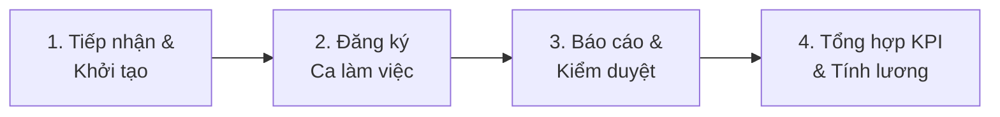
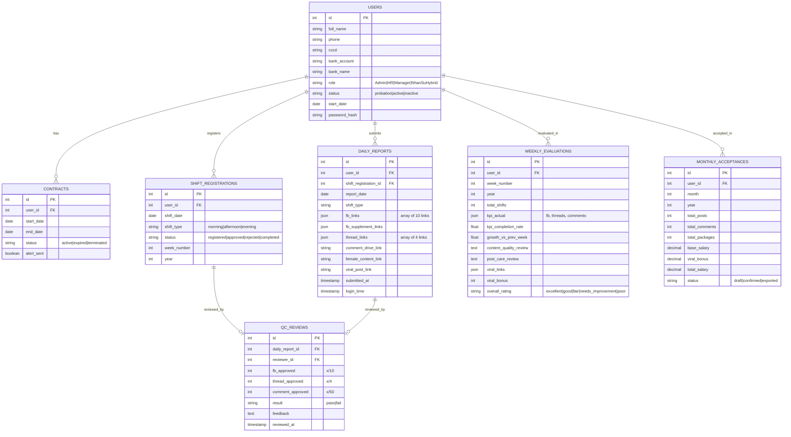

# Web Quản Lý Nhân Sự Hybrid - Freetrip

## Tổng Quan

Xây dựng hệ thống web quản lý nhân sự Hybrid thay thế hoàn toàn quy trình thủ công trên Google Sheets. Hệ thống phục vụ cho nhân sự Hybrid (seeding team), Quản lý trực tiếp (QC), và bộ phận HR/Kế toán tại Freetrip.

---

## Phân Tích Tài Liệu

### 1. Quy Trình Tổng Quan (4 giai đoạn)

### 2. Chi Tiết Quy Trình Nghiệp Vụ

#### Giai đoạn 1: Tiếp nhận & Quản lý Nhân sự (Onboarding & HRM)

| Bước | Người thực hiện | Hành động | Thời gian |
|------|----------------|-----------|-----------|
| 1.1 Thu thập thông tin | HR/Admin | Tạo hồ sơ (Tên, SĐT, CCCD, Ngân hàng) | Ngay khi nhận việc |
| 1.2 Cấp tài khoản | Admin Hệ thống | Tạo User/Password, gán quyền "Nhân sự Hybrid" | Sau 1 ngày nhận việc |
| 1.3 Thử việc | Nhân sự/HR | Làm quen công việc, **KHÔNG ký HĐ** | 1 tuần đầu |
| 1.4 Ký hợp đồng | HR | Ký HĐ khoán việc, thời hạn **3 tháng** | Sau 1 tuần thử việc |
| 1.5 Cảnh báo hết hạn HĐ | **Hệ thống (Auto)** | Gửi thông báo tự động cho QL và HR | Trước 7-14 ngày |

> [!IMPORTANT]
> **Điều kiện nhận lương:** Nhân sự phải làm tối thiểu **3 ngày** mới đủ điều kiện nhận lương.

#### Giai đoạn 2: Đăng ký & Duyệt Ca Làm Việc (Hàng tuần)

| Bước | Người thực hiện | Hành động | Thời gian |
|------|----------------|-----------|-----------|
| 2.1 Mở form đăng ký | **Hệ thống (Auto)** | Gửi thông báo nhắc nhở mở đăng ký ca | **Thứ 6 hàng tuần** |
| 2.2 Đăng ký ca | Nhân sự Hybrid | Tick chọn ca theo khung giờ chuẩn (tối đa **1 ca/ngày**) | Trước **23:59 Chủ Nhật** |
| 2.3 Chốt & Duyệt ca | Quản lý | Xem Grid Matrix tổng thể, chốt ca tuần. Hệ thống **tự động khóa form** | Sau khi hết thời gian ĐK |

**Khung giờ ca làm việc:**
- ☀️ **Ca sáng:** 08:30 - 12:30
- 🌤️ **Ca chiều:** 13:30 - 17:30
- 🌙 **Ca tối:** 20:00 - 24:00

**Quy định:**
- Mỗi người tối đa **1 ca/ngày**
- Tối thiểu **5 ca/tuần** (= 20 ca/tháng)
- Làm trực tiếp tại công ty **1 ca/tuần** (sáng/chiều, Thứ 2-6)
- Nghỉ tối đa **3 ca/20 ca** mỗi tháng
- Phải thông báo trước **1 ngày** khi nghỉ

#### Giai đoạn 3: Báo Cáo & Kiểm Duyệt Seeding (Hàng ngày)

| Bước | Người thực hiện | Hành động | Thời gian |
|------|----------------|-----------|-----------|
| 3.1 Báo cáo hàng ngày | Nhân sự Hybrid | Gắn link bài viết vào hệ thống | Cuối mỗi ca |
| 3.2 Tiêu chuẩn nội dung | Nhân sự Hybrid | Đảm bảo từ khóa bắt buộc, chống vi phạm | Trong ca |
| 3.3 Kiểm duyệt (QC) | Quản lý/QC | Check số lượng, chất lượng, giờ làm → Đạt/Không đạt | Trong vòng **7 ngày** sau ca |

**KPI bắt buộc mỗi ca:**

| Nền tảng | KPI hiện tại (T8/2026) | KPI trước đó |
|----------|----------------------|--------------|
| Facebook | **10 bài** | 5 bài |
| Threads | **4 bài** | 2 bài |
| Comments | **50 comments** | 50 comments |

> [!WARNING]
> - Tuyệt đối **KHÔNG dùng khung chat** của app khác
> - **KHÔNG nhắc tên** thương hiệu/app khác
> - CHỈ được nhắc **Freetrip** và các tính năng của app
> - Từ khóa bắt buộc: freetrip, free.trip, mã qr, secrechat, fastdate...

**Khung giờ vàng đăng bài:**
- Ca sáng: 08:30-09:30 & 11:00-12:30
- Ca chiều: 13:30-14:30 & 16:00-17:30
- Ca tối: 20:00-22:00

#### Giai đoạn 4: Tổng hợp KPI & Tính Lương (Hàng tháng)

| Bước | Người thực hiện | Hành động | Thời gian |
|------|----------------|-----------|-----------|
| 4.1 Chốt số liệu tháng | Quản lý | Tổng kết ca ĐẠT, link ĐẠT, bài viral. Lập **biên bản nghiệm thu** | Ngày 01-05 tháng sau |
| 4.2 Xuất báo cáo tính lương | Admin/Kế toán | Export Excel chuẩn | Ngày 03-05 tháng sau |

### 3. Chính Sách Thưởng Viral

#### Bài đăng:

| Mức tương tác | Thưởng Facebook (VNĐ) | Thưởng Threads (VNĐ) |
|---------------|----------------------|---------------------|
| 500 Likes | 50,000 | — |
| 1K Likes | 80,000 | 50,000 |
| 3K Likes | 100,000 | 80,000 |
| 5K Likes | 200,000 | 100,000 |
| 10K Likes | — | 200,000 |

#### Bình luận:

| Mức tương tác | Thưởng Facebook (VNĐ) | Thưởng Threads (VNĐ) |
|---------------|----------------------|---------------------|
| 500 Likes | 25,000 | — |
| 1K Likes | 50,000 | 25,000 |
| 5K Likes | 80,000 | 50,000 |
| 10K Likes | 100,000 | 80,000 |
| 50K Likes | — | 100,000 |

### 4. Cấu Trúc Biên Bản Nghiệm Thu

Từ ảnh [BIÊN BẢN NGHIỆM THU.jpg](file:///d:/Quang/Cong Viec Dev/WebHybrid/TaiLieu/Quy Trinh Quan Ly nhan su/Bao Cao/BIÊN BẢN NGHIỆM THU.jpg), biên bản gồm các cột:

| STT | Họ và tên | Số lượng bài viết | Số lượng bình luận | Tổng gói sản phẩm | Thù lao | Thưởng | Ký xác nhận |

- Có **24 nhân sự** (tháng 9/2026)
- Ký duyệt bởi: **Phụ trách nghiệm thu** + **Quản lý** + **Xác nhận của Công ty**

### 5. Cấu Trúc Báo Cáo Ngày (từ file Excel 18MB)

Mỗi nhân sự có **1 sheet riêng** với cấu trúc:

| Cột | Mô tả |
|-----|-------|
| STT | Số thứ tự ngày làm |
| Ngày | Ngày cụ thể |
| Ca làm | Sáng/Chiều/Tối |
| Link FB | 10 link bài Facebook |
| Bổ sung | Link bổ sung (nếu bài bị gỡ) |
| Link Threads | 4 link bài Threads |
| Link CMT | Link folder drive chứa screenshot comment |
| Link content nữ | Link bài nhắm user nữ |
| Link bài nổi bật | Bài có tương tác cao |
| Check (QC) | QC ghi nhận: FB: x/10, Threads: x/4, CMT: x/50 |
| Ghi chú | Feedback từ QC/QL |

- Tổng hợp theo **tuần** (TỔNG: số ca, tổng FB, tổng Threads, tổng CMT)

### 6. Cấu Trúc Báo Cáo Tuần/Tháng

Mỗi báo cáo tuần bao gồm:
- **Tổng quan nhân sự:** Số lượng, thời gian, thái độ, nhân sự đi làm nhiều/ít nhất
- **Số lượng user đăng ký** (KPI chiến dịch)
- **Đánh giá content nữ** (tỷ lệ user nữ/nam)
- **Bảng đánh giá chi tiết theo từng nhân sự:**
  - Số ca/tuần
  - KPI yêu cầu vs thực tế (Facebook, Threads, Comments)
  - Mức tăng trưởng so với tuần trước (%)
  - Chất lượng nội dung (đánh giá text)
  - Mức hoàn thành KPI (tỷ lệ %)
  - Chăm sóc bài viết
  - Link bài viral + Link bài chưa tốt
  - Mức thưởng viral dự kiến
  - Đánh giá tổng: Rất tốt / Tốt / Khá / Cần cố gắng / Không tốt

---

## User Review Required

> [!IMPORTANT]
> ### Quyết định kiến trúc
> Cần xác nhận các điểm sau trước khi triển khai:

1. **Tech Stack:** Dự kiến sử dụng **Next.js** (React + Server-side) + **PostgreSQL**. Đồng ý không?
2. **Authentication:** Sử dụng hệ thống phân quyền role-based (Admin, HR, Manager/QC, NhanSuHybrid). Có thêm role nào không?
3. **Thông báo tự động:** Email, push notification qua web, hay tích hợp Zalo/Telegram?
4. **Import dữ liệu cũ:** Có cần import dữ liệu từ các file Excel hiện tại không?
5. **Mobile responsive hay cần app riêng?**

## Open Questions

> [!IMPORTANT]
> 1. **Công thức tính lương cụ thể?** Tài liệu chỉ đề cập "tính công" nhưng chưa nêu rõ đơn giá/ca, cách tính khi ca không đạt, trừ nghỉ quá mức...
> 2. **Trạng thái Offline** (trong đăng ký ca) là gì? Nghỉ có phép hay làm việc offline?
> 3. **Quy trình xử lý khi nhân sự vào muộn >1 tiếng?** Chỉ đề cập "không được phép" nhưng hệ thống xử lý thế nào (khóa ca, trừ lương, cảnh báo)?
> 4. **Check giờ làm:** Hệ thống check giờ thế nào? Tracking qua login/logout hay do QC kiểm tra thủ công?
> 5. **QC kiểm duyệt trong 7 ngày:** Nếu quá 7 ngày chưa kiểm duyệt thì sao? Auto Đạt hay Auto Không đạt?

---

## Proposed Changes

### Module 1: Authentication & User Management

#### [NEW] `src/app/(auth)/login/page.tsx`
- Trang đăng nhập cho tất cả role

#### [NEW] `src/lib/auth/`
- JWT-based authentication
- Role-based access control (RBAC): `Admin`, `HR`, `Manager`, `NhanSuHybrid`
- Middleware bảo vệ route theo role

---

### Module 2: Quản Lý Hồ Sơ Nhân Sự (HRM)

#### [NEW] `src/app/(dashboard)/nhan-su/`
- **CRUD hồ sơ:** Tên, SĐT, CCCD, Ngân hàng, ngày bắt đầu, trạng thái (thử việc/chính thức/nghỉ)
- **Quản lý hợp đồng:** Ngày ký, thời hạn 3 tháng, trạng thái
- **Auto cảnh báo hết hạn HĐ:** Cronjob/scheduler gửi notification trước 7-14 ngày
- **Theo dõi thử việc:** Đếm ngày, nhắc ký HĐ sau 1 tuần

---

### Module 3: Đăng Ký & Quản Lý Ca Làm Việc

#### [NEW] `src/app/(dashboard)/ca-lam-viec/`
- **Form đăng ký ca:** Grid matrix (ngày x ca), tick chọn, tối đa 1 ca/ngày
- **Auto mở form:** Thứ 6 hàng tuần, **auto khóa:** 23:59 Chủ Nhật
- **Grid Matrix tổng thể:** QL xem tất cả nhân sự đăng ký theo tuần
- **Chốt ca:** QL duyệt, hệ thống khóa form
- **Tracking:** Số ca/tuần, số ca/tháng, cảnh báo < 5 ca/tuần
- **Quản lý nghỉ phép:** Đếm số ca nghỉ, cảnh báo > 3 ca/tháng

---

### Module 4: Báo Cáo Seeding Hàng Ngày

#### [NEW] `src/app/(dashboard)/bao-cao/`
- **Form nhập báo cáo:** Nhân sự điền link FB (10), Threads (4), Comment (drive link)
- **Link content nữ, link bài nổi bật:** Trường riêng
- **Auto đếm:** Tổng link FB, Threads hợp lệ
- **Tổng hợp tự động:** Theo tuần (TỔNG ca, FB, Threads, CMT)
- **Timeline view:** Quản lý xem báo cáo theo ngày của từng nhân sự

---

### Module 5: Kiểm Duyệt QC

#### [NEW] `src/app/(dashboard)/kiem-duyet/`
- **Dashboard QC:** Danh sách ca chưa duyệt (sắp xếp theo deadline 7 ngày)
- **Form duyệt:** Check từng loại (FB: x/10, Threads: x/4, CMT: x/50)
- **Đánh giá:** Đạt/Không đạt + Ghi chú feedback
- **Check giờ làm:** Ghi nhận giờ bắt đầu, cảnh báo vào muộn >1 tiếng
- **Khóa/Mở ca:** QL chủ động khóa/mở ca cho từng nhân sự

---

### Module 6: Tổng Hợp KPI & Báo Cáo

#### [NEW] `src/app/(dashboard)/kpi/`
- **Báo cáo tuần:**
  - Tổng quan nhân sự
  - Bảng KPI đạt/thực tế theo từng người
  - % hoàn thành KPI
  - So sánh tăng trưởng vs tuần trước
  - Đánh giá chất lượng nội dung
  - Link bài viral + mức thưởng dự kiến
  - Xếp hạng nhân sự: Rất tốt → Không tốt
- **Báo cáo tháng:**
  - Tổng hợp tất cả tuần
  - Tổng ca ĐẠT / Tổng link ĐẠT
  - Mức thưởng viral tổng
  - Số user đăng ký (KPI chiến dịch)
  - Tỷ lệ user nữ/nam

---

### Module 7: Biên Bản Nghiệm Thu & Tính Lương

#### [NEW] `src/app/(dashboard)/nghiem-thu/`
- **Tạo biên bản nghiệm thu:** Auto fill từ dữ liệu KPI tháng
  - Họ tên, Số lượng bài viết, Số lượng bình luận, Tổng gói sản phẩm, Thù lao, Thưởng
- **Export Excel:** Định dạng chuẩn (như biên bản nghiệm thu hiện tại)
- **Export PDF:** Biên bản ký số / in ký tay
- **Tính lương tự động:** Dựa trên số ca ĐẠT × đơn giá + thưởng viral

---

### Module 8: Dashboard Tổng Quan

#### [NEW] `src/app/(dashboard)/page.tsx`
- **Admin/HR:** Tổng nhân sự, HĐ sắp hết hạn, tổng user đăng ký
- **Manager/QC:** Ca cần duyệt, nhân sự chưa đăng ký ca, KPI overview
- **Nhân sự:** Ca đã đăng ký tuần này, KPI cá nhân, thưởng dự kiến

---

### Database Schema (PostgreSQL)

---

## Verification Plan

### Automated Tests
- Unit tests cho logic tính KPI, tính lương, auto-lock form
- Integration tests cho CRUD nhân sự, đăng ký ca, báo cáo ngày
- E2E tests cho flow hoàn chỉnh: đăng ký ca → báo cáo → QC → nghiệm thu

### Manual Verification
- So sánh kết quả tính KPI/lương với dữ liệu Excel hiện tại
- Kiểm tra biên bản nghiệm thu export khớp format mẫu
- Test phân quyền: nhân sự không truy cập được chức năng QL
- Test auto notification: cảnh báo HĐ hết hạn, nhắc đăng ký ca
