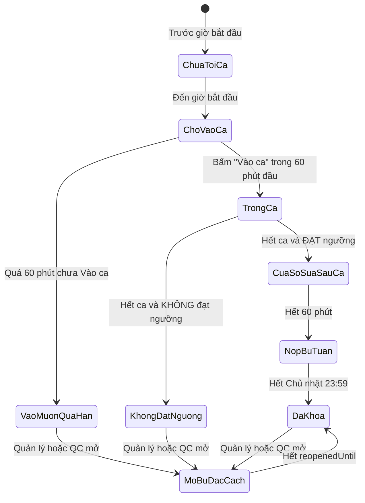
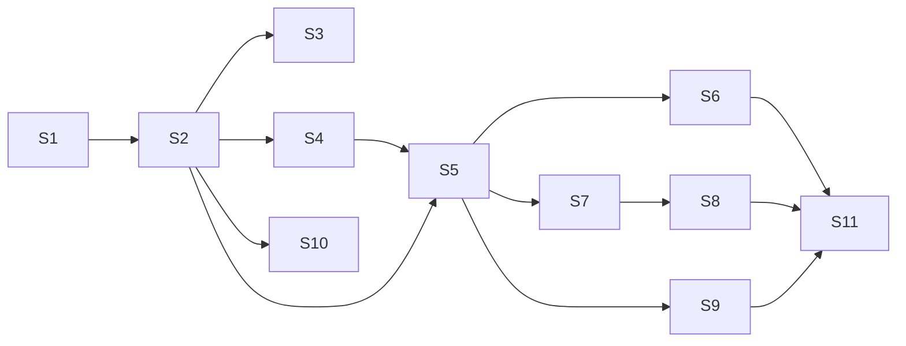

# Plan: Quy tắc Nộp bù tự động theo ca

> **Trạng thái:** Đã chốt quyết định nghiệp vụ, chờ triển khai.
> **Thuật ngữ:** dùng theo [CONTEXT.md](../CONTEXT.md).
> **Mục tiêu:** Quản lý không phải mở nộp bù thủ công cho từng nhân sự. Hệ thống tự mở hoặc khóa theo quy tắc. Quản lý chỉ xử lý các ca ngoại lệ bằng **Mở bù đặc cách**.

---

## 1. Hiện trạng và vấn đề

| Cơ chế hiện tại | Vị trí | Vấn đề |
|---|---|---|
| Chỉ nộp được trong giờ ca, hết ca là khóa | `api/reports/route.ts` (POST) | Không có thời gian nộp muộn, mọi trường hợp phải mở tay |
| `REOPEN_SHIFT`: QC hoặc Quản lý mở từng ca, có `reopenedUntil` | `api/qc/attendance/route.ts` | Mở từng ca, tốn thời gian khi có khoảng 20 nhân sự |
| `REOPEN_USER`: mở cả tuần cho một người qua `reopenedUserIds` | `api/shifts/manage/route.ts` | **Không có hạn**, nhân sự sửa được báo cáo cũ bất kỳ lúc nào |
| `KpiConfig.lateThresholdMinutes = 60` | Trang KPI trong Admin | Đã có cấu hình nhưng **chưa được dùng** |
| Bảng `LoginSession` (`loginTime`, `isLate`, `lateMinutes`) | `schema.prisma` | Nhân sự chưa có thao tác điểm danh, bảng này chỉ được ghi khi QC đánh vắng |

---

## 2. Quy tắc nghiệp vụ đã chốt

### 2.1 Các giai đoạn của một ca



| Giai đoạn | Thời gian | Điều kiện | Quyền với link |
|---|---|---|---|
| **Chờ Vào ca** | Bắt đầu ca → +60 phút | Ca đã đăng ký | Chưa được nộp |
| **Trong ca** | Từ lúc Vào ca → hết ca | Đã Vào ca đúng hạn | Thêm, sửa, xóa tự do (như hiện tại) |
| **Cửa sổ sửa sau ca** | Hết ca → +60 phút | **Đạt Ngưỡng tham gia ca** | Thêm hoặc thay. **Không xóa** link QC đã duyệt hợp lệ |
| **Nộp bù tuần** | Sau Cửa sổ sửa sau ca → Chủ nhật 23:59 | **Đạt Ngưỡng tham gia ca** | Thêm hoặc thay, **không vượt KPI ca**. Không xóa link đã duyệt hợp lệ |
| **Vào muộn quá hạn** | Sau 60 phút đầu ca mà chưa Vào ca | — | Khóa. Chỉ mở lại bằng Mở bù đặc cách |
| **Không đạt ngưỡng** | Từ lúc hết ca | Dưới ngưỡng | Khóa. Chỉ mở lại bằng Mở bù đặc cách |
| **Mở bù đặc cách** | Đến `reopenedUntil` | QC hoặc Quản lý mở tay (`REOPEN_SHIFT`) | Ghi đè mọi trạng thái khóa |

### 2.2 Ngưỡng tham gia ca

- Ngưỡng tính **theo từng loại link**, **làm tròn lên**, chỉ đếm các link nộp **trong giờ ca** và chốt **tại thời điểm hết ca**.
- Với KPI hiện tại (10 FB, 4 Thread):
  - FB: `ceil(10 × 70%) = 7`
  - Thread: `ceil(4 × 70%) = 3`
- Link comment trên Drive **không** tính vào ngưỡng.
- Link nộp trong Cửa sổ sửa sau ca hoặc Nộp bù tuần **không** được tính lại vào ngưỡng.

### 2.3 Các quy tắc đi kèm

| # | Quy tắc |
|---|---|
| R1 | Nộp muộn **không ảnh hưởng KPI**. Link nộp bù được tính KPI như link nộp trong ca |
| R2 | Ca **Vào muộn quá hạn** hoặc **Không đạt ngưỡng** **không tự tính là vắng**. Quản lý xem xét từng trường hợp |
| R3 | **Ca tối Chủ nhật** vẫn có đủ 60 phút sửa sau ca, tức đến 00:59 thứ Hai. Quản lý làm báo cáo từ sáng thứ Hai |
| R4 | **Hàng đợi QC** chỉ nhận báo cáo **sau khi Cửa sổ sửa sau ca đóng**. Link thêm hoặc thay trong Nộp bù tuần phải **duyệt lại riêng link đó** |
| R5 | **QC và Quản lý** đều đánh dấu được link lỗi. Đánh dấu xong thì gửi **thông báo tự động** cho nhân sự |
| R6 | Nhắc nhở: **30 phút trước khi hết ca** nếu chưa đạt ngưỡng, và **tối thứ Bảy** nếu còn link lỗi chưa thay |
| R7 | `REOPEN_SHIFT` được giữ làm **Mở bù đặc cách** |
| R8 | `REOPEN_USER` chỉ còn dùng để **sửa lịch đăng ký ca**, **bỏ** quyền nộp báo cáo |
| R9 | SUPER_ADMIN được chỉnh 3 con số: **phút vào muộn** (dùng lại `lateThresholdMinutes`), **phút sửa sau ca** và **% ngưỡng** |

---

## 3. Hướng triển khai

### Kiến trúc chính: một nơi duy nhất quyết định quyền nộp

Hiện nay logic quyền nộp bị lặp ở hai nơi: server (`api/reports/route.ts`) và client (`getShiftStatusInfo` trong `bao-cao/page.tsx`). Đề xuất gom về **một hàm thuần** dùng chung cho cả hai:

```ts
// app/src/lib/reportSubmissionPolicy.ts
type SubmissionPhase =
  | "BEFORE_SHIFT" | "AWAITING_CHECKIN" | "LATE_LOCKED"
  | "IN_SHIFT" | "POST_SHIFT_EDIT" | "WEEKLY_MAKEUP"
  | "BELOW_THRESHOLD" | "SPECIAL_REOPEN" | "CLOSED";

interface SubmissionDecision {
  phase: SubmissionPhase;
  canSubmit: boolean;
  canDeleteApprovedLinks: boolean;
  capAtKpi: boolean;
  closesAt: Date | null;
  reason: string; // Thông báo tiếng Việt cho UI và lỗi API
}

evaluateSubmission(input: {
  shift, checkIn, endSnapshot, report, qcReview, now, rules, kpi
}): SubmissionDecision
```

> **Phương án A (hiệu năng):** sửa trực tiếp các nhánh `if` trong route. Nhanh, nhưng logic tiếp tục lặp ở client và server.
> **Phương án B (dễ bảo trì, khuyến nghị):** dùng hàm thuần `evaluateSubmission`, viết test theo TDD cho đủ các mốc thời gian. Mọi quy tắc nằm ở một chỗ, client chỉ hiển thị kết quả.

### Chốt số link tại lúc hết ca theo kiểu "lười"

Không có scheduler nên **không chạy job lúc hết ca**. Thay vào đó, ở lần đầu tiên có thao tác đọc hoặc ghi báo cáo **sau khi hết ca**, nếu chưa có bản chốt thì tạo bản chốt từ link hiện tại. Lúc đó link chắc chắn chưa đổi kể từ khi hết ca, vì mọi thao tác ghi sau giờ ca đều đi qua bước này trước.

- Thêm các trường mới vào `DailyReport`: `endFbCount`, `endThreadCount`, `thresholdMet Boolean?`, `endSnapshotAt`.

---

## 4. Các phần việc (để giao triển khai)

| # | Phần việc | File chính | Phụ thuộc |
|---|---|---|---|
| S1 | **Cấu hình:** thêm `postShiftEditMinutes=60`, `participationThresholdPercent=70` vào `DEFAULT_SHIFT_RULES`, thêm UI trong Admin. Dùng lại `lateThresholdMinutes` | `api/admin/shifts-config/route.ts`, `admin/page.tsx` | — |
| S2 | **Hàm `evaluateSubmission`** và bộ test cho đủ các giai đoạn ở mục 2.1 | `lib/reportSubmissionPolicy.ts` | S1 |
| S3 | **Vào ca:** API `POST /api/shifts/check-in` ghi `LoginSession` (`loginTime`, `isLate`, `lateMinutes`), thêm nút "Vào ca" ở trang báo cáo | `api/shifts/check-in/route.ts`, `bao-cao/page.tsx` | S2 |
| S4 | **Chốt số link lúc hết ca:** migration thêm trường vào `DailyReport`, chốt kiểu "lười" | `schema.prisma`, `api/reports/route.ts` | S2 |
| S5 | **Áp dụng policy vào API nộp:** chặn xóa link đã duyệt, giới hạn theo KPI trong Nộp bù tuần | `api/reports/route.ts` (POST) | S2, S4 |
| S6 | **UI báo cáo:** thay `getShiftStatusInfo` bằng kết quả từ policy, hiển thị giai đoạn và đếm ngược `closesAt` | `bao-cao/page.tsx` | S5 |
| S7 | **Hàng đợi QC:** ẩn báo cáo khi Cửa sổ sửa sau ca chưa đóng. Đánh dấu "cần duyệt lại" cho link thay mới | `api/qc/queue/route.ts`, `kiem-duyet/page.tsx` | S5 |
| S8 | **Quản lý đánh dấu link lỗi** trên màn hình làm báo cáo, ghi vào `invalidLinks` và gửi thông báo | màn hình báo cáo nhân sự, `Notification` | S7 |
| S9 | **Tách `REOPEN_USER`:** bỏ kiểm tra `reopenedUserIds` trong `api/reports` và `effectiveReopenedBy` ở GET, sửa câu thông báo ở `ca-lam-viec/page.tsx` (khoảng dòng 1484) | `api/reports/route.ts`, `ca-lam-viec/page.tsx` | S5 |
| S10 | **Nhắc nhở** theo R6 | xem mục 5, câu D1 | S2 |
| S11 | **Cập nhật tài liệu** hướng dẫn sử dụng | `docs/huong_dan_su_dung_tu_a_den_z.md` | S1–S9 |



---

## 5. Câu hỏi còn mở

| # | Câu hỏi | Đề xuất mặc định |
|---|---|---|
| D1 | **Nhắc nhở R6 chạy bằng gì?** Dự án chưa có scheduler | (a) Banner trong app, tính lúc nhân sự mở trang, không cần cron. (b) Task Scheduler hoặc cron gọi `/api/cron/reminders` để gửi thông báo thật. **Đề xuất (a) trước, (b) sau** |
| D2 | **Được bấm Vào ca sớm hơn giờ bắt đầu không** (ví dụ trước 10 phút)? | Không. Chỉ từ giờ bắt đầu ca, khớp với quy tắc hiện tại "không nộp trước ca" |
| D3 | **Tuần nằm vắt qua 2 tháng:** Nộp bù tuần kéo sang tháng sau thì nghiệm thu tháng chốt lúc nào? | Nghiệm thu tháng chốt sau khi Nộp bù tuần của tuần cuối đã đóng |
| D4 | **Chuyển đổi:** áp dụng từ tuần nào? Ca của tuần đang chạy chưa có bản chốt số link | Áp dụng từ **thứ Hai tuần kế tiếp** sau khi deploy |

## 6. Ngoài phạm vi

- Crawler tự quét link chết rồi đánh dấu lỗi (để giai đoạn sau).
- Chế tài trừ KPI khi nộp muộn (đã chốt R1: không ảnh hưởng).
- Ghi chú phát hiện thêm: `getShiftTimeRange` trong `api/reports/route.ts` đang ghi cứng giờ ca, không đọc `shift_times`. Nên sửa riêng, nhưng S2 phải đọc giờ ca từ cấu hình.
