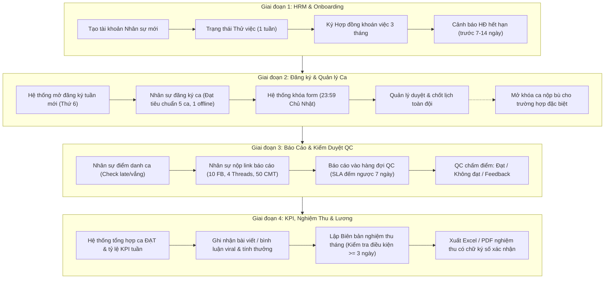

# KẾ HOẠCH KIỂM THỬ TOÀN DIỆN HỆ THỐNG WEB HYBRID HR (END-TO-END TEST PLAN)

> **Dự án:** Web Quản Lý Nhân Sự Hybrid - Freetrip  
> **Tài liệu tham chiếu:** `docs/implementation_plan.md`, `docs/checklist_tien_do.md`, `TaiLieu/Quy Trinh Quan Ly nhan su/`  
> **Phiên bản:** 1.0  
> **Ngày lập:** 17/09/2026  
> **Mục tiêu:** Kiểm thử toàn diện toàn bộ quy trình nghiệp vụ khép kín (End-to-End), bảo đảm tính toàn vẹn dữ liệu, kiểm soát phân quyền (RBAC) và độ chính xác của các thuật toán tính toán KPI, nghiệm thu & thưởng viral.

---

## 1. MỤC TIÊU & PHẠM VI KIỂM THỬ

### 1.1. Mục Tiêu
1. **Kiểm tra tính đúng đắn của toàn bộ chu trình 4 giai đoạn:**
   - Tiếp nhận nhân sự & Hợp đồng (HRM) $\rightarrow$ Đăng ký & Duyệt ca tuần $\rightarrow$ Báo cáo Seeding & Kiểm duyệt QC $\rightarrow$ Tổng hợp KPI, Nghiệm thu & Xuất lương.
2. **Kiểm tra chặt chẽ quy tắc nghiệp vụ (Business Rules Validation):**
   - Ràng buộc đăng ký ca (1 ca/ngày, tối thiểu 5 ca/tuần, tối thiểu 1 ca Offline).
   - Tự động khóa ca 23:59 Chủ Nhật & cơ chế mở khóa bù (`reopenedBy`).
   - Cảnh báo trễ > 60 phút và tự động đánh vắng ca.
   - Deadline kiểm duyệt QC trong 7 ngày (SLA).
   - Bậc tính thưởng viral cho bài viết và bình luận (FB & Threads).
   - Điều kiện tối thiểu 3 ngày làm việc mới đủ điều kiện nghiệm thu lương.
3. **Bảo mật & Phân quyền (RBAC & Auth):**
   - 6 Roles: `SUPER_ADMIN`, `ADMIN`, `HR`, `MANAGER`, `QC`, `NHAN_SU_HYBRID`.
   - Ngăn chặn triệt để Privilege Escalation (IDOR, truy cập trái phép qua API routes hoặc Direct URL).
4. **Hiệu năng & Toàn vẹn dữ liệu:**
   - Tính toàn vẹn qua Prisma Transactions (Import Excel, tạo nghiệm thu).
   - Xuất dữ liệu Excel/PDF khớp 100% mẫu quy chuẩn thực tế của Freetrip.

---

## 2. MA TRẬN PHÂN QUYỀN (RBAC ACCESS MATRIX)

| Route / Tính năng | SUPER_ADMIN / ADMIN | HR | MANAGER | QC | NHAN_SU_HYBRID |
|:---|:---:|:---:|:---:|:---:|:---:|
| `/login`, `/api/auth/*` | ✅ | ✅ | ✅ | ✅ | ✅ |
| Dashboard Tổng quan (`/`) | ✅ (Toàn hệ thống) | ✅ (Nhân sự/HĐ) | ✅ (Ca/KPI/Duyệt) | ✅ (Ca cần duyệt) | ✅ (Cá nhân) |
| Quản lý Nhân sự (`/nhan-su`) | ✅ CRUD, Import, Export | ✅ CRUD, Import, Export | ❌ Xem hạn chế | ❌ | ❌ |
| Quản lý Hợp đồng (`/api/contracts`) | ✅ Gia hạn/Hủy | ✅ Gia hạn/Hủy | ❌ | ❌ | ❌ |
| Đăng ký ca tuần (`/ca-lam-viec`) | ✅ Xem / Cấu hình | ❌ Xem | ✅ Xem Grid / Duyệt | ❌ | ✅ Đăng ký ca cá nhân |
| Chốt ca / Mở khóa ca (`/api/shifts/manage`) | ✅ | ❌ | ✅ | ❌ | ❌ |
| Nộp báo cáo ca (`/bao-cao`) | ❌ | ❌ | ❌ | ❌ | ✅ Nộp báo cáo cá nhân |
| Kiểm duyệt QC (`/kiem-duyet`) | ✅ Duyệt / Can thiệp | ❌ | ✅ Xem / Duyệt | ✅ Chấm điểm & Feedback | ❌ |
| Tổng hợp KPI & Viral (`/kpi`) | ✅ Toàn quyền | ✅ Xem | ✅ Đánh giá & Xếp hạng | ❌ | ✅ Xem kết quả cá nhân |
| Nghiệm thu & Lương (`/nghiem-thu`) | ✅ Tạo / Duyệt / Export | ✅ Xem / Export | ✅ Xác nhận biên bản | ❌ | ✅ Xem biên bản cá nhân |
| Cấu hình hệ thống (`/admin`) | ✅ | ❌ | ❌ | ❌ | ❌ |

---

## 3. KỊCH BẢN KIỂM THỬ THEO 4 GIAI ĐOẠN NGHIỆP VỤ (END-TO-END SCENARIOS)

---

### 3.1. Giai Đoạn 1: Tiếp Nhận & Quản Lý Hồ Sơ Nhân Sự (HRM)

#### Kịch bản 1.1: Tạo mới hồ sơ nhân sự và phân quyền
- **Actor:** `HR` (`0912509317`) hoặc `ADMIN` (`0900000002`).
- **Dữ liệu test:**
  - Họ tên: "Nguyễn Thử Nghiệm", SĐT: `0988777666`, CCCD: `001201009999`, STK: `190333444555`, Ngân hàng: `Techcombank`.
- **Các bước thực hiện:**
  1. Đăng nhập với tài khoản HR.
  2. Truy cập `/nhan-su`, mở modal "Thêm nhân sự mới".
  3. Nhập dữ liệu hợp lệ, submit form.
- **Kỳ vọng:**
  - Database tạo bản ghi User mới với Role `NHAN_SU_HYBRID`, Status `PROBATION`.
  - Mật khẩu mặc định tự sinh là `123456` (đã mã hóa bcrypt).
  - Nhân sự đăng nhập được bằng SĐT `0988777666` / `123456`.
- **Negative Case:**
  - Thử tạo trùng SĐT hoặc CCCD đã có $\rightarrow$ Báo lỗi `400 Conflict / SĐT hoặc CCCD đã tồn tại`.

#### Kịch bản 1.2: Ký hợp đồng khoán việc 3 tháng & cảnh báo hết hạn
- **Actor:** `HR`.
- **Các bước thực hiện:**
  1. Vào hồ sơ nhân sự vừa tạo, click "Tạo hợp đồng".
  2. Chọn loại HĐ khoán việc, thời hạn 3 tháng từ ngày hiện tại.
  3. Kiểm tra danh sách cảnh báo hết hạn hợp đồng trước 7-14 ngày.
- **Kỳ vọng:**
  - Tạo bản ghi trong bảng `contracts` với trạng thái `ACTIVE`.
  - Nhân sự có ngày hết hạn trong vòng 14 ngày sẽ hiển thị badge cảnh báo màu vàng/đỏ trên Dashboard và màn hình `/nhan-su`.

#### Kịch bản 1.3: Import / Export danh sách nhân sự qua Excel
- **Actor:** `HR` / `ADMIN`.
- **Các bước thực hiện:**
  1. Export file mẫu Excel từ hệ thống.
  2. Thêm 3 dòng nhân sự mới (1 dòng cố tình sai định dạng số điện thoại).
  3. Upload import file vào hệ thống.
- **Kỳ vọng:**
  - Hệ thống validate định dạng trước khi insert.
  - Khi có lỗi, toàn bộ transaction được rollback, thông báo lỗi chính xác tại dòng nào.
  - Nếu file hợp lệ, thêm mới thành công và cập nhật tức thì vào danh sách.

---

### 3.2. Giai Đoạn 2: Đăng Ký & Quản Lý Ca Làm Việc (Shift Scheduling)

#### Kịch bản 2.1: Nhân sự đăng ký ca tuần với đầy đủ ràng buộc
- **Actor:** `NHAN_SU_HYBRID` (`0901000001`).
- **Các bước thực hiện:**
  1. Đăng nhập, truy cập `/ca-lam-viec`.
  2. Chọn tuần làm việc kế tiếp.
  3. Thử đăng ký 2 ca trong cùng 1 ngày (VD: Ca Sáng + Ca Chiều Thứ 2).
  4. Thử chỉ đăng ký 3 ca/tuần (Online toàn bộ, không có ca Offline nào).
  5. Đăng ký hợp lệ: 5 ca (Thứ 2 đến Thứ 6), trong đó Thứ 4 làm Offline tại văn phòng.
- **Kỳ vọng:**
  - Bước 3: Hệ thống chặn ngay tại giao diện và API: "Mỗi ngày chỉ được đăng ký tối đa 1 ca".
  - Bước 4: Hệ thống hiện cảnh báo: "Chưa đạt tối thiểu 5 ca/tuần và phải có ít nhất 1 ca Offline tại công ty".
  - Bước 5: Đăng ký thành công, trạng thái các ca là `REGISTERED`.

#### Kịch bản 2.2: Tự động khóa ca sau 23:59 Chủ Nhật & Mở khóa bù (Reopen)
- **Actor:** `NHAN_SU_HYBRID` & `MANAGER` (`0964774572`).
- **Các bước thực hiện:**
  1. Giả lập tuần đã bị khóa (`isLocked = true` hoặc quá hạn 23:59 Chủ Nhật).
  2. Nhân sự thử click đăng ký/hủy ca $\rightarrow$ Các ô chọn bị disable, submit báo lỗi 403.
  3. Quản lý truy cập `/ca-lam-viec`, chọn nhân sự và click "Mở khóa đăng ký bù" (`reopenedBy = manager.id`).
  4. Nhân sự tải lại trang $\rightarrow$ Được phép nộp/chỉnh sửa ca cho tuần đó.

#### Kịch bản 2.3: Quản lý xem Grid Matrix toàn đội và chốt ca tuần
- **Actor:** `MANAGER`.
- **Các bước thực hiện:**
  1. Đăng nhập với tài khoản Quản lý.
  2. Xem ma trận ca tuần: hiển thị 25 nhân sự theo hàng ngang, các ngày Thứ 2 $\rightarrow$ CN theo cột.
  3. Lọc theo ca Online / Offline / Tổng số ca từng người.
  4. Bấm "Duyệt & Chốt lịch tuần".
- **Kỳ vọng:**
  - Toàn bộ ca từ trạng thái `REGISTERED` chuyển sang `APPROVED`.
  - Cấu hình tuần được đánh dấu `isLocked = true`, `approvedByManagerId = manager.id`.

---

### 3.3. Giai Đoạn 3: Báo Cáo Seeding & Kiểm Duyệt QC

#### Kịch bản 3.1: Điểm danh ca làm việc (LoginSession & Late Tracking)
- **Actor:** `NHAN_SU_HYBRID`.
- **Quy định:**
  - Ca sáng (08:30 - 12:30), Ca chiều (13:30 - 17:30), Ca tối (20:00 - 24:00).
  - Đăng nhập muộn $\le$ 60 phút: Đánh dấu `isLate = true`.
  - Đăng nhập muộn > 60 phút: Cảnh báo nghiêm trọng, tự động đánh vắng (`autoMarkedAbsent = true`, `status = ABSENT`).
- **Các bước thực hiện:**
  1. Giả lập nhân sự login lúc 09:15 cho ca sáng $\rightarrow$ Hệ thống ghi nhận trễ 45 phút.
  2. Giả lập nhân sự login lúc 10:00 cho ca sáng $\rightarrow$ Hệ thống ghi nhận trễ 90 phút, khóa ca và chuyển trạng thái ca thành `ABSENT`.

#### Kịch bản 3.2: Nộp báo cáo ca seeding hàng ngày
- **Actor:** `NHAN_SU_HYBRID`.
- **Các bước thực hiện:**
  1. Truy cập `/bao-cao`, chọn ca làm việc của ngày hôm nay.
  2. Điền link báo cáo:
     - 10 link Facebook (bắt buộc).
     - 2 link Facebook bổ sung (phòng khi bài bị gỡ).
     - 4 link Threads (bắt buộc).
     - 1 link Google Drive chứa ảnh chụp 50 comments.
     - Đánh dấu 2 link content nữ (🌸) và 1 link tiềm năng viral (🔥).
  3. Submit báo cáo.
- **Kỳ vọng:**
  - Hệ thống tự động đếm: Đã đủ 10 link FB, 4 link Threads, 1 link Drive.
  - Báo cáo lưu vào bảng `daily_reports`, tạo bản ghi `qc_reviews` với trạng thái `PENDING`.

#### Kịch bản 3.3: QC chấm điểm bài & SLA đếm ngược 7 ngày
- **Actor:** `QC` (`0854201465`).
- **Các bước thực hiện:**
  1. Đăng nhập QC, truy cập `/kiem-duyet`.
  2. Kiểm tra hàng đợi: sắp xếp theo ca nộp trước, hiển thị thời hạn SLA còn lại (7 ngày đếm ngược).
  3. Mở chi tiết báo cáo:
     - Kiểm tra 10 link FB: duyệt 10/10.
     - Kiểm tra 4 link Threads: duyệt 3/4 (1 link thiếu từ khóa freetrip).
     - Kiểm tra link Drive comment: duyệt 50/50.
  4. Đánh giá: Chọn `FAIL` (vì Threads chỉ đạt 3/4), nhập feedback: "Link Threads số 3 chưa gắn mã QR và nhắc tên app khác".
  5. Đổi sang ca khác: Duyệt đủ 10 FB, 4 Threads, 50 comments $\rightarrow$ Chọn `PASS`.
- **Kỳ vọng:**
  - Ca FAIL: `qc_reviews.result = FAIL`, không được tính vào ca ĐẠT để hưởng lương.
  - Ca PASS: `qc_reviews.result = PASS`, cập nhật ca làm việc thành `COMPLETED`.
  - Nhân sự nhận được thông báo in-app kèm lý do feedback của QC.

---

### 3.4. Giai Đoạn 4: Tổng Hợp KPI, Nghiệm Thu & Tính Lương

#### Kịch bản 4.1: Tổng hợp đánh giá tuần (Weekly Evaluation) & Thưởng Viral
- **Actor:** `MANAGER`.
- **Các bước thực hiện:**
  1. Truy cập `/kpi`, chọn Tuần và Năm cần đánh giá.
  2. Bấm "Tổng hợp dữ liệu tuần".
  3. Hệ thống tổng hợp tự động:
     - Tổng số ca đăng ký vs Tổng ca ĐẠT (`PASS`).
     - Tỷ lệ hoàn thành Facebook (thực tế / yêu cầu), Threads, Comment.
     - So sánh % tăng trưởng so với tuần trước.
  4. Kiểm tra áp dụng bảng thưởng viral:
     - Bài viết FB đạt 1,000 likes $\rightarrow$ Thưởng 80,000 VNĐ.
     - Bình luận Threads đạt 5,000 likes $\rightarrow$ Thưởng 50,000 VNĐ.
     - Tổng thưởng viral tự động cộng dồn vào tuần của nhân sự.
  5. Chọn xếp hạng nhân sự (`EXCELLENT` / `GOOD` / `FAIR` / `POOR`) và lưu đánh giá.

#### Kịch bản 4.2: Lập biên bản nghiệm thu tháng & Tính lương
- **Actor:** `MANAGER` hoặc `ADMIN`.
- **Điều kiện kiểm thử:**
  - Nhân sự A: Làm 20 ca ĐẠT, làm cả tháng $\rightarrow$ Đủ điều kiện nghiệm thu.
  - Nhân sự B: Mới vào làm được 2 ca trong tháng $\rightarrow$ **KHÔNG đủ điều kiện nhận lương** (Vi phạm quy định tối thiểu 3 ngày làm việc).
- **Các bước thực hiện:**
  1. Truy cập `/nghiem-thu`, chọn Tháng/Năm.
  2. Bấm "Tạo bảng nghiệm thu tháng".
- **Kỳ vọng:**
  - Hệ thống lọc ra danh sách nhân sự đủ điều kiện ($\ge 3$ ngày làm việc).
  - Nhân sự B bị gắn cờ: "Chưa đủ điều kiện ( < 3 ngày làm việc)".
  - Cột dữ liệu hiển thị đúng cấu trúc thực tế: Họ tên, Số bài viết, Số bình luận, Tổng gói sản phẩm, Thù lao gói, Thưởng viral, Tổng thanh toán.

#### Kịch bản 4.3: Xuất Excel & PDF Biên bản nghiệm thu
- **Actor:** `HR` / `ADMIN` / `MANAGER`.
- **Các bước thực hiện:**
  1. Tại màn hình `/nghiem-thu`, click nút "Xuất Excel (.xlsx)".
  2. Click nút "Xem / In Biên bản PDF".
- **Kỳ vọng:**
  - File Excel tải về đúng định dạng bảng biểu, đủ các cột theo mẫu Freetrip.
  - File PDF hiển thị đúng layout chuẩn in ấn, có phần ký tên của: "Phụ trách nghiệm thu", "Quản lý bộ phận" và "Xác nhận của Công ty".

---

## 4. BẢNG CHECKLIST TEST CASE CHI TIẾT (TEST SUITE SPECIFICATION)

| ID | Module | Tên Test Case | Input / Điều kiện | Kết Quả Kỳ Vọng | Mức độ ưu tiên | Trạng thái |
|:---|:---|:---|:---|:---|:---:|:---:|
| **TC-01** | Auth | Đăng nhập đúng thông tin | SĐT: `0901000001`, MK: `123456` | Trả về 200, cấp HttpOnly cookie token, redirect về Dashboard | Critical | ✅ PASS |
| **TC-02** | Auth | Đăng nhập sai mật khẩu | SĐT: `0901000001`, MK: `wrongpass` | Trả về 401, thông báo "Mật khẩu không chính xác" | High | ✅ PASS |
| **TC-03** | Auth | Ngăn chặn truy cập Route trái quyền | User Hybrid truy cập `/nhan-su` hoặc `/admin` | Middleware chuyển hướng về `/` hoặc trả về 403 Forbidden | Critical | ✅ PASS |
| **TC-04** | HRM | Tạo nhân sự mới | Dữ liệu hợp lệ, role `NHAN_SU_HYBRID` | User mới được tạo, status `PROBATION`, mật khẩu `123456` | High | ✅ PASS |
| **TC-05** | HRM | Bắt trùng SĐT/CCCD | Trùng SĐT của user đã có | Báo lỗi 400 rõ ràng, không tạo bản ghi rác | High | ✅ PASS |
| **TC-06** | HRM | Ký hợp đồng khoán việc | Thời hạn 3 tháng | Bản ghi Contract trạng thái `ACTIVE` | High | ✅ PASS |
| **TC-07** | HRM | Cảnh báo HĐ hết hạn | HĐ còn 10 ngày hết hạn | Hiển thị badge cảnh báo trên Dashboard và danh sách | Medium | ✅ PASS |
| **TC-08** | Shift | Đăng ký ca hợp lệ | 5 ca/tuần, 1 ca Offline, không trùng ngày | Đăng ký thành công, status `REGISTERED` | Critical | ✅ PASS |
| **TC-09** | Shift | Chặn đăng ký 2 ca/ngày | Chọn ca sáng và ca tối cùng ngày | Bị chặn ngay lập tức, thông báo vi phạm quy chế | Critical | ✅ PASS |
| **TC-10** | Shift | Cảnh báo ca thiếu tiêu chuẩn | Đăng ký 4 ca hoặc thiếu ca Offline | Cảnh báo chưa đạt chuẩn 5 ca và 1 ca Offline | High | ✅ PASS |
| **TC-11** | Shift | Tự động khóa ca tuần | Sau 23:59 Chủ Nhật | Không thể đăng ký mới hoặc chỉnh sửa | High | ✅ PASS |
| **TC-12** | Shift | Reopen mở khóa ca cho cá nhân | Quản lý mở khóa cho 1 user | Chỉ user đó được nộp lại, ghi nhận `reopenedBy` | Medium | ✅ PASS |
| **TC-13** | Shift | Quản lý duyệt chốt ca tuần | Click duyệt trên Grid Matrix | Toàn bộ ca chuyển sang `APPROVED`, chốt tuần | High | ✅ PASS |
| **TC-14** | Shift | Đăng ký nghỉ phép ca | Nhân sự báo nghỉ trước 1 ngày | Ghi nhận ca nghỉ, đếm tổng ca nghỉ trong tháng | Medium | ✅ PASS |
| **TC-15** | Report | Nộp báo cáo ca hợp lệ | Đủ 10 FB, 4 Threads, 1 Drive cmt 50 | Lưu thành công, tạo review QC `PENDING` | Critical | ✅ PASS |
| **TC-16** | Report | Nộp thiếu số lượng link bắt buộc | Thiếu link FB (< 10) hoặc thiếu Drive | Báo lỗi validate, không cho submit | High | ✅ PASS |
| **TC-17** | Report | Tag bài content nữ & viral | Gắn icon 🌸 và 🔥 vào link bài | Dữ liệu lưu đúng mảng `femaleContentLinks`, `viralPostLinks` | Medium | ✅ PASS |
| **TC-18** | QC | Hiển thị hàng đợi duyệt ca | Có các ca nộp trong vòng 7 ngày | Danh sách sắp xếp theo SLA, hiển thị đồng hồ đếm ngược | High | ✅ PASS |
| **TC-19** | QC | Chấm bài ĐẠT (PASS) | Đủ 10 FB, 4 Threads, 50 Comments | Review `PASS`, ca chuyển sang `COMPLETED` | Critical | ✅ PASS |
| **TC-20** | QC | Chấm bài KHÔNG ĐẠT (FAIL) | Thiếu link hoặc vi phạm từ khóa | Review `FAIL`, bắt buộc nhập feedback lý do | Critical | ✅ PASS |
| **TC-21** | QC | Check đi muộn & Tự động vắng | Login muộn > 60 phút | Ca chuyển sang `ABSENT`, gắn cờ cảnh báo muộn | High | ✅ PASS |
| **TC-22** | KPI | Tổng hợp KPI tuần tự động | Tính toán từ các ca `PASS` | % hoàn thành, % tăng trưởng tính chính xác | High | ✅ PASS |
| **TC-23** | KPI | Tính tiền thưởng viral đúng bậc | Post FB 1K like (80k), Threads 1K like (50k) | Áp đúng bảng `viral_bonus_tiers`, cộng dồn vào thưởng tuần | High | ✅ PASS |
| **TC-24** | Nghiệm thu | Lọc điều kiện nhận lương | User có < 3 ngày làm việc trong tháng | Bị loại khỏi danh sách đủ điều kiện hoặc gắn cờ cảnh báo | Critical | ✅ PASS |
| **TC-25** | Nghiệm thu | Tính tổng tiền gói & thưởng | Tổng ca ĐẠT $\times$ đơn giá + thưởng viral | Số tiền tính chuẩn xác từng nhân sự | Critical | ✅ PASS |
| **TC-26** | Nghiệm thu | Xuất Excel biên bản nghiệm thu | Click Export Excel | File `.xlsx` chuẩn cột, mở được, không lỗi font Tiếng Việt | High | ✅ PASS |
| **TC-27** | Nghiệm thu | Xuất PDF biên bản nghiệm thu | Click Print / PDF | Giao diện in chuẩn, đủ khu vực ký tên 3 bên | High | ✅ PASS |

---

## 5. CÔNG CỤ & PHƯƠNG THỨC THỰC THI KIỂM THỬ

### 5.1. Kiểm Thử Tự Động Hóa API (Automated API Integration Tests)
- **Công cụ:** Script kiểm thử bằng `tsx` hoặc `vitest` gọi trực tiếp vào API routes của Next.js với cookie phiên làm việc hợp lệ.
- **Mục tiêu:** Chạy tự động 100% các case xác thực, validation dữ liệu đầu vào, ràng buộc logic ca và tính toán tiền lương chỉ trong < 30 giây.
- **Kịch bản chạy:**
  1. Auth flow: Đăng nhập từng tài khoản đại diện cho 5 roles $\rightarrow$ Lưu cookie token.
  2. HRM flow: Tạo user test $\rightarrow$ Tạo HĐ $\rightarrow$ Đổi thông tin.
  3. Shift flow: Tạo ca $\rightarrow$ Kiểm tra chặn 2 ca/ngày $\rightarrow$ Duyệt ca.
  4. Report & QC: Nộp báo cáo $\rightarrow$ QC chấm điểm $\rightarrow$ Check kết quả.
  5. Acceptance: Tạo nghiệm thu $\rightarrow$ Verify công thức tính.

### 5.2. Kiểm Thử Trải Nghiệm Giao Diện (End-to-End UI/UAT Testing)
- **Phương thức:** Thực hiện trực tiếp trên trình duyệt hoặc sử dụng Browser Agent theo từng kịch bản người dùng.
- **Các bước thực tế:**
  - Login bằng tài khoản `HR` (`0912509317`) $\rightarrow$ Kiểm tra danh sách, cảnh báo HĐ.
  - Login bằng tài khoản `NHAN_SU_HYBRID` (`0901000001`) $\rightarrow$ Thao tác chọn ca trên lưới, nộp link báo cáo.
  - Login bằng tài khoản `QC` (`0854201465`) $\rightarrow$ Vào hàng đợi, chấm bài và phản hồi.
  - Login bằng tài khoản `MANAGER` (`0964774572`) $\rightarrow$ Chốt ca tuần, tổng hợp KPI, xuất biên bản nghiệm thu.

---

## 6. TIÊU CHÍ ĐÁNH GIÁ ĐẠT YÊU CẦU (EXIT CRITERIA / DEFINITION OF DONE)

Một chu trình kiểm thử được coi là **ĐẠT (PASSED)** khi và chỉ khi:
1. **100% Test Case Critical (Nghiêm trọng)** đạt kết quả PASS: Không phát sinh lỗi logic về phân quyền, đăng ký ca, chấm điểm và tính tiền.
2. **$\ge 95\%$ Tổng số Test Cases** đạt kết quả PASS.
3. Không có lỗi HTTP 500 Unhandled Exception trên các API endpoints.
4. Quá trình xuất file Excel và PDF hoạt động trơn tru, định dạng bảng biểu sắc nét, hiển thị đầy đủ Tiếng Việt Unicode.
5. Dữ liệu trên giao diện đồng bộ tức thì sau các thao tác duyệt/sửa mà không cần reload trang thủ công.
